<!-- SPDX-License-Identifier: AGPL-3.0-or-later · © 2026 rrstudio — rrstudio Tools -->

<p align="center">
  
</p>

<h1 align="center">rrstudio Tools</h1>

<p align="center">
  Free, open source web tools that run entirely in your browser.<br>
  <strong>Your data stays on your computer.</strong>
</p>

<p align="center">
  <a href="https://tools.rr-dev.eu"><strong>Live demo → tools.rr-dev.eu</strong></a> ·
  <a href="https://demo.rr-dev.eu">Premium dashboards</a> ·
  <a href="https://ko-fi.com/rrstudioapps">Buy me a coffee</a>
</p>

<p align="center">
  <a href="LICENSE"></a>
  <a href="../../actions/workflows/build.yml"></a>
</p>


## Languages and URLs

The language of a page is decided by its URL, not by the browser or a saved preference. The root is Italian (`/`, `/pdf-tools`); the English versions live under `/en/` with the same slugs (`/en/`, `/en/pdf-tools`). Every page is prerendered in its own language, with `<html lang>`, title, description, Open Graph tags, `canonical` and `hreflang` links (`it`, `en`, and `x-default` pointing to English). `public/sitemap.xml` lists all of them with `xhtml:link` alternates. Each tool has its own 1200×630 social image per language (`public/og/<lang>/<slug>.png`, generated by `npm run og-images`), used for `og:image` and `twitter:image`; the home pages use `public/og-image.png`.

Tools that only make sense in Italy (codice fiscale, IBAN & partita IVA, e-invoice, VAT & withholding calculator) are flagged `italyOnly` in the registry: they have no `/en/` page, the EN switch is disabled on them, and the English home links to them in a discreet line. An unknown `/en/...` address goes to `/en/`. Visitors whose browser is not in Italian get a small, dismissible hint on Italian pages that have an English version; there is no automatic redirect.

## Tools

The home page groups the tools by category, with filter pills (shareable as `?categoria=sviluppatori`, or `?category=developers` on the English home) and a search box (press `/` or `Ctrl+K` / `⌘K` to jump to it).

### Text

Write, compare, sort and clean up text.

| Tool | What it does |
|---|---|
| [**Text compare (diff)**](https://tools.rr-dev.eu/text-diff) | Compare two texts or files line by line (Myers algorithm), with word or character differences inside changed lines, side-by-side or inline view, options to ignore whitespace, case and blank lines, navigation between differences and export as a unified diff (`.patch`). Runs in a Web Worker, fine with 5,000 lines. |
| [**Markdown editor**](https://tools.rr-dev.eu/markdown-editor) | Write Markdown (CommonMark + GFM: headings, lists and task lists, tables with alignment, quotes, code blocks with language) with a live side-by-side preview, a formatting toolbar and shortcuts. Safe preview: raw HTML is never run and external images are not loaded. Export `.md`, a standalone HTML file or PDF (browser print). The draft stays in your browser. |
| [**Word & character counter**](https://tools.rr-dev.eu/word-counter) | Words, characters (with and without spaces, emoji and accents count 1), sentences, paragraphs, lines, reading (about 200 wpm) and speaking (about 130 wpm) time, most frequent words without Italian/English stopwords, length limits (SMS, X, meta description, title, Instagram) and case conversions. |
| [**Text case converter**](https://tools.rr-dev.eu/case-converter) | camelCase, PascalCase, snake_case, SCREAMING_SNAKE, kebab-case, Train-Case, dot.case, path/case, Title Case (English and Italian rules, with elisions), Sentence case, upper/lower and aLtErNaTiNg, line by line, with acronyms and accents handled. |
| [**Lorem ipsum generator**](https://tools.rr-dev.eu/lorem-ipsum-generator) | Paragraphs, sentences or words, optional classic opening, text or HTML `<p>`, deterministic generator with an optional seed for repeatable output. |
| [**Sort lines**](https://tools.rr-dev.eu/sort-lines) | Sort lines alphabetically (`Intl.Collator`, Italian or English rules), naturally, by length, by frequency, in reverse or randomly; remove duplicates (with or without case, spaces), blank lines and margins, count occurrences, add prefix, suffix and numbering. |
| [**Find and replace**](https://tools.rr-dev.eu/find-replace) | Plain-text or regex find and replace (flags g, i, m, s, u, `$1` and `$<name>` groups, case, whole words), several rules in sequence, highlighted preview with counts. Runs in a Web Worker with a timeout against catastrophic regexes. |
| [**Text to speech**](https://tools.rr-dev.eu/text-to-speech) | Read a text aloud with the Web Speech API: voice and language, speed, pitch, volume, pause/resume/stop and a highlighted sentence. Only local voices (`localService`) are shown and used: network voices would send the text to external servers. |

### Data

Tables and structured formats.

| Tool | What it does |
|---|---|
| [**CSV → Dashboard**](https://tools.rr-dev.eu/csv-dashboard) | Drop a CSV or Excel file and get KPI cards, a time chart, a category chart and a filterable, sortable table. Customize columns, chart types, color and title, then export as a self-contained HTML file, PNG or PDF. |
| [**CSV, JSON & Excel converter**](https://tools.rr-dev.eu/csv-json-converter) | Convert CSV, JSON and Excel into each other: automatic delimiter, header row, array of objects or of arrays, nested objects flattened to `a.b` and rebuilt, sheet picker, table preview. Formulas in the exported CSV and XLSX are neutralised. |
| [**JSON Formatter and Validator**](https://tools.rr-dev.eu/json-formatter) | Format (2 / 4 spaces or tab), minify and sort keys, with live validation: errors show line and column, plus size, key count and depth, and light syntax highlighting. |
| [**JSON Viewer & Editor**](https://tools.rr-dev.eu/json-viewer) | Explore JSON as a lazy, paginated tree (files up to 50 MB), search keys and values, copy the JavaScript path or JSON Pointer of a node, edit values and keys inline, add, delete, duplicate, move and retype nodes, with undo/redo and a formatted Text view. |
| [**YAML / JSON / TOML converter**](https://tools.rr-dev.eu/yaml-json-converter) | Convert between YAML, JSON and TOML in every direction (`yaml` and `smol-toml`), multiple YAML documents, anchors and merge keys, 2/4-space or tab indentation, sorted keys, errors with line and column and a "go to error" button, file upload and download. |
| [**XML formatter**](https://tools.rr-dev.eu/xml-formatter) | Format or minify XML keeping comments, CDATA, entities and `xml:space="preserve"`; well-formedness checks with line and column errors (plus the browser's DOMParser as second opinion) and a simple XML to JSON conversion. |
| [**SQL formatter**](https://tools.rr-dev.eu/sql-formatter) | Format or minify SQL (`sql-formatter`) for standard SQL, PostgreSQL, MySQL, MariaDB, SQLite, T-SQL, BigQuery, PL/SQL and more, keyword case and indentation; the minifier never touches strings, quoted names or hints. |
| [**Fake data generator**](https://tools.rr-dev.eu/fake-data-generator) | 1 to 10,000 rows of made-up test data (names, emails on reserved test domains, Italian phones and addresses, birth dates, UUID, numbers, lorem, colors) with formally valid Italian tax codes, VAT numbers and IBANs (correct check digits, invented bank codes). Optional seed for repeatable output, field order, table preview, CSV (any separator), JSON and SQL `INSERT` export. Chunked generation keeps the page responsive. |
| [**JSONPath, JSON → TypeScript, JSON Schema**](https://tools.rr-dev.eu/json-query) | A JSONPath playground (RFC 9535 plus Goessner extensions: filters with `&&` `||` `!` `=~`, slices, `..`, `length()`/`count()`/`match()`/`search()`), evaluated without `eval`, with the normalized path of every result and syntax errors with position. Extra tabs turn the same JSON into TypeScript interfaces (union types, optional keys) and a JSON Schema (draft 2020-12). |

### Images, PDF & codes

Images, PDFs, QR codes and barcodes.

| Tool | What it does |
|---|---|
| [**QR code generator**](https://tools.rr-dev.eu/qr-code-generator) | QR codes for text, links, WiFi, contacts (vCard), email, SMS and locations, with error correction, size, margin, colours (with a low-contrast warning) and an optional centre logo. Download PNG or SVG, or copy the image. |
| [**Image compressor & converter**](https://tools.rr-dev.eu/image-compressor) | Compress and convert many images at once to JPEG, WebP, PNG or AVIF, with quality and resize options, a before/after slider and a ZIP download. Done in your browser; EXIF metadata (GPS included) is stripped. |
| [**PDF tools: merge, split, rotate**](https://tools.rr-dev.eu/pdf-tools) | Merge several PDFs, extract or split pages (every page, every N pages or by ranges like `1-3, 5, 8-10`), rotate, delete and reorder pages from a grid of thumbnails. Your PDFs are never uploaded: fine for confidential documents. |
| [**Images to PDF**](https://tools.rr-dev.eu/images-to-pdf) | Combine JPG, PNG and WebP images into one PDF: reorder the thumbnails (drag & drop or keyboard), choose A4, Letter or fit-to-image pages, orientation, margins, 1, 2 or 4 images per page and the quality. EXIF orientation is respected. |
| [**PDF to images**](https://tools.rr-dev.eu/pdf-to-images) | Turn PDF pages (all, or a range like `1-3, 5`) into PNG or JPEG at 72, 150 or 300 dpi, with previews and single or ZIP download. |
| [**Barcode generator**](https://tools.rr-dev.eu/barcode-generator) | EAN-13, EAN-8, UPC-A, Code 128, Code 39, ITF-14, ITF, Codabar, MSI and Pharmacode with `jsbarcode`: validation, computed check digit, bar width, height, text and colours, SVG or PNG download, and bulk generation from a list into a ZIP. |
| [**QR code reader**](https://tools.rr-dev.eu/qr-code-reader) | Read QR codes from an uploaded, dropped or pasted image or with the camera (only on request, stopped on exit) using `jsQR`. Recognises URLs, Wi-Fi, vCard, email, phone, SMS, location and text; links are shown as text with warnings and never opened automatically. |

### Calculators

Percentages, units, dates, time zones and number bases.

| Tool | What it does |
|---|---|
| [**Unix timestamp converter**](https://tools.rr-dev.eu/timestamp-converter) | Timestamp to date (seconds, milliseconds, microseconds or nanoseconds, detected) and date to timestamp, ISO 8601, RFC 2822 and a readable format, any time zone of your browser with daylight saving handled, a live "now", relative time, and many timestamps at once (one per line). |
| [**Percentage calculator**](https://tools.rr-dev.eu/percentage-calculator) | Five calculations on one page: X% of Y, X is what % of Y, percentage change from A to B, add or subtract a percentage (discount, markup, VAT) and reverse percentage (the price before a discount). Live results with a copy button, clear errors for division by zero and a 100% discount. |
| [**Unit converter**](https://tools.rr-dev.eu/unit-converter) | Length, mass, temperature, area, volume, speed, time, digital data (SI KB and binary KiB), pressure and energy. Search a unit by name or symbol across all categories, swap units and see the value in every unit of the category. Temperature goes through Celsius and refuses values below absolute zero. |
| [**Date and age calculator**](https://tools.rr-dev.eu/date-calculator) | Difference between two dates in years, months and days (plus total days and weeks, end day optional), add or subtract days, weeks, months and years, and exact age with the days to the next birthday. Month ends (31 January + 1 month) and leap years (29 February) are handled. |
| [**Time zone converter**](https://tools.rr-dev.eu/timezone-converter) | Convert a time between IANA time zones and compare several at once. Zones and daylight saving come from `Intl` only (no time zone database is shipped); search by city, nonexistent and repeated local times at DST changes are flagged. |
| [**Number base converter**](https://tools.rr-dev.eu/number-base-converter) | Binary, octal, decimal, hexadecimal and any base from 2 to 36 with BigInt (no size limit), two's complement at 8, 16, 32 and 64 bits with a bit view, and IEEE-754 float32 and float64: decode a bit pattern or encode a number, with the exact stored decimal value. |

### Developers

Encode, decode and compute.

| Tool | What it does |
|---|---|
| [**Regex tester**](https://tools.rr-dev.eu/regex-tester) | Test JavaScript regular expressions: flags `g i m s u y d`, highlighted matches, numbered and named groups, replacement preview (`$1`, `$<name>`, `$&`), the pattern explained in plain words and an example library. Runs in a Web Worker with a 1 second timeout, so catastrophic backtracking cannot freeze the page. |
| [**Base64 Encode/Decode**](https://tools.rr-dev.eu/base64) | Encode and decode text or files to Base64 with correct UTF-8, an URL-safe option and data URLs. Drop a file to get its Base64, or decode back to a downloadable file with an image preview. |
| [**URL Encode/Decode**](https://tools.rr-dev.eu/url-encode) | Percent-encode and decode text, as a component or as a full URL, with optional "space as +". Shows a copyable table of the URL parts and decoded query parameters. |
| [**Hash & checksum**](https://tools.rr-dev.eu/hash-generator) | MD5, SHA-1, SHA-256, SHA-384 and SHA-512 of a text (live) or a file up to 2 GB, in hex and Base64, with a progress bar, cancel and a "compare with a checksum" field. |
| [**JWT decoder**](https://tools.rr-dev.eu/jwt-decoder) | Paste a JSON Web Token (a leading `Bearer ` is fine) and read the header and payload, highlighted, the algorithm and the `exp`, `iat`, `nbf` and `auth_time` dates in your time zone and in UTC with "expires in…/expired … ago". Clear errors for missing segments, bad Base64URL or JSON; JWE (5 segments) is recognised. The signature is **not** verified. |
| [**UUID generator**](https://tools.rr-dev.eu/uuid-generator) | UUID v4, UUID v7 (correct timestamp, monotonic within a millisecond) and ULID, 1-1000 at a time, upper/lower case, with or without hyphens, with braces; copy all or download a `.txt`. A validator reads the version, variant and the date inside v7 and ULID. Only `crypto.getRandomValues`. |
| [**HTML entities & escaping**](https://tools.rr-dev.eu/html-entities) | Encode/decode HTML entities (named, decimal, hex; basic, non-ASCII or every character) without touching the DOM, plus escape/unescape for JavaScript and JSON strings and URL components, with error positions. |
| [**Cron expressions**](https://tools.rr-dev.eu/cron-expression) | Explain cron in Italian or English (`cronstrue`), validate 5 or 6 fields and `@daily`-style aliases with clear errors, field editor with presets, next N runs in local time or UTC with Vixie's day-of-month/day-of-week rule and DST handling. |
| [**chmod calculator**](https://tools.rr-dev.eu/chmod-calculator) | Tick r/w/x for owner, group and others plus setuid, setgid and sticky; octal (3 or 4 digits), symbolic (`rwxr-xr-x`, with s/S/t/T) and the `chmod` command stay in sync. Apply expressions such as `u+x,go-w` to the current permissions, and pick common presets (644, 755, 600…) with an explanation. |
| [**.htpasswd generator**](https://tools.rr-dev.eu/htpasswd-generator) | `.htpasswd` lines for several users with bcrypt (`$2y$`, chosen cost, computed in a Web Worker), APR1-MD5 or `{SHA}` (the last two flagged as weak), plus a checker that tests a password against an existing line. |
| [**Certificate decoder**](https://tools.rr-dev.eu/certificate-decoder) | Paste PEM or load a PEM/DER/CRT/CSR file: X.509 certificates (also chains) and PKCS#10 requests with subject, issuer, validity and days to expiry, SANs, key usage, extended key usage, basic constraints, key algorithm and size, serial, SHA-1/SHA-256 fingerprints, SKI/AKI. |
| [**Meta tag preview**](https://tools.rr-dev.eu/meta-tag-preview) | Paste a page's HTML (or just the `<head>`) or fill in the fields: title, description, canonical, Open Graph, Twitter Card, favicon, robots and hreflang are extracted and shown as generic previews (Google result, Facebook/LinkedIn card, X, WhatsApp/Telegram). Checks for lengths, missing or duplicate tags and relative URLs, plus a generated HTML snippet. No network requests. |
| [**Sign a PDF**](https://tools.rr-dev.eu/pdf-sign) | Sign a PDF in the browser: draw (mouse, touch, pen), type or upload your signature (optional white-background removal), place and resize it by dragging or with the keyboard on several pages, add a date, download the signed PDF. A graphic signature, not a digital or qualified one. |
| [**Crop images**](https://tools.rr-dev.eu/image-crop) | Crop with draggable handles or keyboard (free, 1:1, 4:3, 3:2, 16:9, 9:16, 4:5, 35×45 mm ID photo), rotate by 90° or any angle, flip, resize, respect EXIF orientation, export PNG/JPEG/WebP with quality. Metadata is not copied. |

### Web & design

Colors, CSS, SVG and icons.

| Tool | What it does |
|---|---|
| [**Slug generator**](https://tools.rr-dev.eu/slug-generator) | URL slugs from text: accents and extended Latin transliterated, separator, maximum length without splitting words, Italian/English stop words and bulk mode (one slug per line, unique duplicates). |
| [**Color contrast checker (WCAG)**](https://tools.rr-dev.eu/color-contrast-checker) | Two colors (picker or HEX, rgb(), hsl(), oklch(), CSS names, with alpha), WCAG 2.x contrast ratio with AA/AAA for normal text, large text and graphical objects, preview, swap, copyable HEX/RGB/HSL/OKLCH and the closest color (lightness in OKLCH) that reaches AA and AAA. |
| [**CSS unit converter**](https://tools.rr-dev.eu/css-unit-converter) | px, rem, em, pt, pc, %, vw, vh, cm, mm and inches with your own root and parent font size and viewport; a quick px-to-rem table and bulk conversion of a pasted stylesheet (comments, strings, `url()` and `@media` left alone). |
| [**CSS generator**](https://tools.rr-dev.eu/css-generator) | Linear, radial and conic gradients (draggable or numeric color stops with opacity, angle, center, repeating) and multi-layer `box-shadow` (inset, offset, blur, spread, color with alpha), with a live preview and copyable CSS. |
| [**SVG optimizer**](https://tools.rr-dev.eu/svg-optimizer) | Shrink SVGs with SVGO (safe default preset): precision, viewBox kept by default, metadata and comments, before/after sizes, side-by-side preview as an image (SVG is never injected into the page), many files at once with a ZIP download. |
| [**Favicon generator**](https://tools.rr-dev.eu/favicon-generator) | From an image (PNG, JPG, SVG) or a letter or emoji, with colors, shape, padding and crop: `favicon.ico` (16, 32, 48 PNG-in-ICO), PNGs at 16, 32, 180 (apple-touch-icon), 192 and 512, `site.webmanifest` and the HTML snippet, all in a ZIP. |

### Security

Strong passwords, two-factor codes, encrypted files and photo metadata.

| Tool | What it does |
|---|---|
| [**Password generator**](https://tools.rr-dev.eu/password-generator) | Random passwords (4-128 characters, choose the character sets, exclude ambiguous ones) and passphrases (3-12 words from the EFF large wordlist), with honest entropy in bits, a strength bar and the estimated time to guess. Nothing is stored. |
| [**EXIF viewer & remover**](https://tools.rr-dev.eu/exif-viewer) | See the EXIF, GPS, XMP and IPTC metadata of JPEG, PNG and WebP photos, with warnings for GPS, serial numbers and owner names, and remove it with no recompression (pixels stay identical). Before/after field counts, single or ZIP download. |
| [**Password strength checker**](https://tools.rr-dev.eu/password-strength-checker) | Score 0-4 with `zxcvbn-ts` (common, English and Italian dictionaries, loaded only on this page), estimated time to crack in four attack scenarios, entropy, warnings and suggestions in Italian and English. No online check (no Have I Been Pwned): the password never leaves the page. |
| [**TOTP generator (2FA)**](https://tools.rr-dev.eu/totp-generator) | TOTP codes (RFC 6238) from a Base32 secret or an `otpauth://` URI: SHA-1/256/512, 6-8 digits, any period, current code with countdown plus previous and next, verification with a tolerance of ±N periods, otpauth QR. HMAC with WebCrypto, tested with the RFC vectors. |
| [**Encrypt and decrypt files**](https://tools.rr-dev.eu/file-encrypt) | Encrypt files and text with a passphrase: AES-256-GCM, key from PBKDF2-SHA256 (600,000 iterations, random salt), documented `.rrenc` format with an authenticated header, clear error on a wrong passphrase or tampering. Files up to 256 MB, text as Base64. |

### Italy: tax & banking

Codice fiscale, IBAN, VAT number and electronic invoices.

| Tool | What it does |
|---|---|
| [**Italian tax code (codice fiscale)**](https://tools.rr-dev.eu/codice-fiscale) | Calculate the codice fiscale (official DM 23/12/1976 rules, Italian municipality with type-ahead search, foreign country or manual code) and check and decode a code: structure, check character, sex, birth date (century ambiguity) and place, omocodia included. |
| [**IBAN & Italian VAT validator**](https://tools.rr-dev.eu/iban-partita-iva) | One field that recognises an IBAN or a partita IVA, plus separate tabs and a bulk check (one value per line, CSV export). IBAN: mod-97, length and format per country, Italian CIN/ABI/CAB. VAT: check digit and office code. |
| [**VAT, VAT extraction & withholding tax (in Italian)**](https://tools.rr-dev.eu/calcolo-iva) | Add or extract Italian VAT (22/10/5/4/0%), prepare a freelancer invoice with INPS surcharge, pension fund, 20% withholding tax, 2 € stamp duty and the flat-rate regime (with the legal notes to print on the invoice), and work backwards from the net you want to receive. Integer-cent arithmetic; indicative, not tax advice; 2026 rules. |
| [**Italian e-invoice viewer (FatturaPA XML/P7M)**](https://tools.rr-dev.eu/fattura-elettronica) | Open an electronic invoice as XML, signed .p7m (DER or Base64) or a ZIP of invoices and read it laid out: parties, lines, VAT summary, totals, payment, attachments. Print or save as PDF. The signature is not verified. |
| [**Working days calculator (in Italian)**](https://tools.rr-dev.eu/calcolo-giorni-lavorativi) | Working days between two dates (calendar days, weekends, holidays on weekdays listed) or a deadline by adding/subtracting working days. Italian national holidays with Easter (Gauss/Meeus algorithm), optional patron saint of a regional capital and one custom date. Indicative. |
| [**Withholding tax calculator (in Italian)**](https://tools.rr-dev.eu/calcolo-ritenuta-acconto) | Gross to net and net to gross for an occasional service or a freelancer fee: editable withholding rate (20%), optional 4% INPS surcharge, pension fund with its own percentage, optional VAT and the 2 € stamp duty above 77.47 € (charged to the client or not), with a copyable line-by-line statement. Integer-cent arithmetic. |
| [**Mortgage payment calculator (in Italian)**](https://tools.rr-dev.eu/calcolo-rata-mutuo) | Payment, total interest and a full French amortization schedule from principal, nominal rate (TAN) and term in years and months; monthly, quarterly or half-yearly payments, TAN 0% supported, paginated table and CSV export. |
| [**Numbers in words (in Italian)**](https://tools.rr-dev.eu/numeri-in-lettere) | Writes a number (decimals, negatives, up to 999 billion) in correct Italian: ventuno, centottanta, ventitré, milleuno, un milione. Cheque mode gives the cents as digits (`milleduecentotrentaquattro/56`), with an optional "euro". |

More tools are coming, with the same rule: nothing leaves your browser.

### CSV → Dashboard

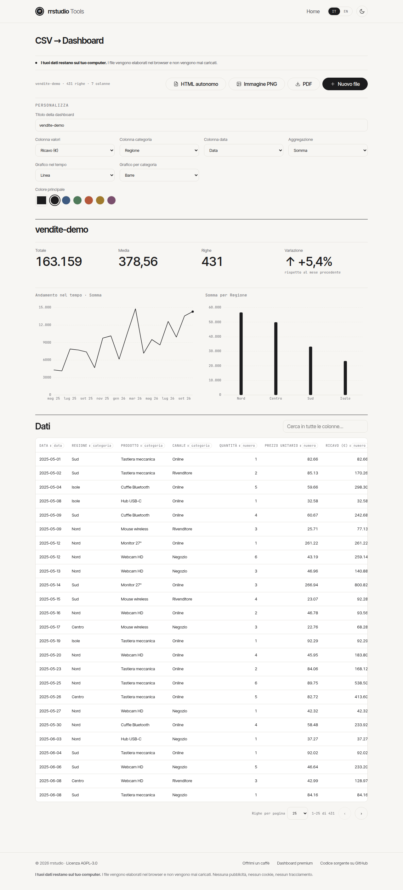

<details>
<summary>Dark theme and mobile</summary>


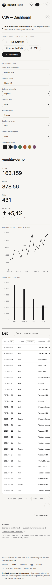
</details>

- CSV (any delimiter, UTF-8 or Windows-1252) and XLSX/XLS files, via drag & drop or file picker.
- Automatic column type detection: date, number (Italian and English formats, currency, %), category, text.
- KPI cards: total, average, row count, change versus the previous period when there is a date column.
- Line/area/bar chart over time and bar/pie chart by category (Apache ECharts).
- Exports: a single offline HTML file, PNG and multi-page PDF.
- "Try with sample data" with a demo sales CSV.
- Italian and English UI, light and dark theme, responsive.

### Base64 Encode/Decode


- Live encode/decode with correct UTF-8 (accents, emoji), URL-safe option, whitespace and padding tolerant decoding.
- Files up to 25 MB by drag & drop, optionally as a data URL, with an image preview.
- Decoding a data URL or binary Base64 offers "Download file" (MIME from the data URL or magic bytes: png, jpg, gif, webp, pdf, zip).

### QR code generator

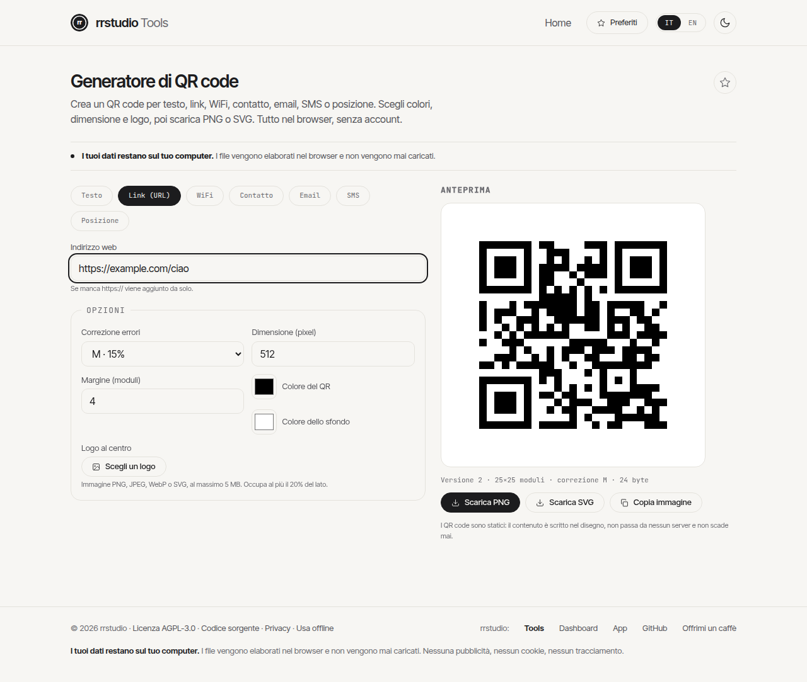

- Route `/qr-code-generator` (also `/en/qr-code-generator`). Types: text, URL (`https://` added when missing), WiFi (`WIFI:T:…;S:…;P:…;H:…;;` with `\ ; , : "` escaped), contact (vCard 3.0), email (`mailto:` with subject and body), SMS (`sms:` with body) and location (`geo:`).
- The encoder is written in plain TypeScript (ISO/IEC 18004, no library): numeric, alphanumeric and byte (UTF-8) modes, versions 1-40, error correction L/M/Q/H with Reed-Solomon, the four mask penalties. Tests check known codewords from the standard, the capacity tables and a round trip through a test-only decoder with Reed-Solomon correction for all 160 version/level combinations.
- Options: size in pixels, margin (quiet zone), colours with a warning when the contrast is too low or the code is inverted, and an optional centre logo (your image, reduced in the browser; it forces level H and covers at most 20% of the side). Export PNG at the chosen size, vector SVG, or copy the image where the browser allows it.
- QR codes are static: they never go through a server and never expire.

### Image compressor & converter

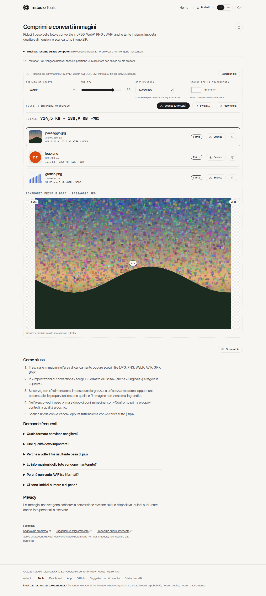

- Up to 50 images (JPG, PNG, WebP, AVIF, GIF first frame, BMP), 50 MB each, by drag & drop or file picker.
- Output: original format, JPEG, WebP, PNG or AVIF (only the formats your browser can actually encode are offered); quality 1-100; resize by max width, max height or percentage (never enlarges); background colour for transparency in JPEG.
- Decoding, resizing and encoding run in a Web Worker (`createImageBitmap` + `OffscreenCanvas`), with a main-thread fallback. EXIF orientation is respected and all metadata, GPS included, is removed.
- Per-file before/after size and pixels, saving in %, a draggable (and keyboard-operable) before/after slider, single download and a ZIP of everything (fflate, MIT, loaded on demand). If a result is larger than the original in the same format, the original is kept.

### PDF tools: merge, split, rotate


- Up to 20 PDFs (100 MB each) by drag & drop or file picker; password-protected files are skipped with a clear message. Every page of every file appears in one grid of thumbnails, with its number and a discreet colour and label for the source file.
- Per page: rotate left/right, delete, select. Reorder by drag & drop (native HTML5) or with the move buttons / Alt + arrow keys, with screen-reader announcements.
- Actions: merge everything in the current order and rotation, extract the selected pages, rotate all, or split (every page, every N pages, or by ranges such as `1-3, 5, 8-10`, validated with clear errors). Several output files come as a ZIP (fflate).
- Output PDFs are built with pdf-lib (MIT); Producer/Creator are "rrstudio Tools" and the title of the first file is kept. Thumbnails are drawn lazily, one at a time, with pdf.js (Apache-2.0); its worker and standard fonts are served from the same origin (no CDN, no `unsafe-eval`).

### Images to PDF


- Route `/images-to-pdf`. Up to 100 images (JPG, PNG, WebP, 50 MB each) as thumbnails that can be reordered by drag & drop, with buttons or with Alt + arrow keys (screen-reader announcements). HEIC is not supported by browsers: a clear message explains how to export a JPG.
- Page: A4, Letter or "fit to image" (the page has the image's proportions at 150 dpi), orientation automatic/portrait/landscape, margins none/5/10/20 mm, 1, 2 or 4 images per page.
- Quality 100 keeps JPG and PNG files byte for byte (lossless); lower values re-encode them as JPEG. EXIF orientation is respected. The PDF is built with pdf-lib (MIT); pages are laid out by a pure, unit-tested function.
- The mode switch moves to `/pdf-to-images` (same page component, mode preset by the route).

### PDF to images


- Route `/pdf-to-images`. One PDF (100 MB; password-protected files are refused with a clear message), pages all or by range (same parser as the PDF tools, with clear errors), PNG or JPEG, 72, 150 or 300 dpi, up to 50 pages per run.
- Pages are drawn with pdf.js (Apache-2.0), whose worker comes from the same origin; very large pages are scaled down to 50 megapixels. Previews, single download or a ZIP (fflate).

### EXIF viewer & remover


- JPEG, PNG and WebP (HEIC is reported as unsupported). A purpose-written, bounds-checked parser reads EXIF/TIFF (JPEG APP1, PNG `eXIf`, WebP `EXIF`), XMP and IPTC, PNG text chunks and the embedded thumbnail, grouped as camera, date and time, shooting settings, software, author and copyright.
- Warnings for GPS, serial numbers and owner or author names. GPS shows coordinates, altitude and accuracy plus a plain text link "Open on OpenStreetMap": no map or external request is made unless you click it.
- Removal does not recompress: JPEG drops the APP1 (EXIF/XMP), APP13 (IPTC) and comment segments; PNG drops `eXIf`, `tEXt`, `zTXt`, `iTXt` and `tIME`; WebP drops the `EXIF` and `XMP ` chunks and updates the VP8X header and the RIFF size. For photos with an EXIF orientation other than 1 you choose between keeping a minimal EXIF with only the orientation, or rotating the pixels (which recompresses). Tests check that the cleaned file has no metadata left and that the image data is byte for byte identical.
- Before/after field counts and bytes saved; single download or ZIP.

### CSV, JSON & Excel converter


- Route `/csv-json-converter`. Input from pasted text or a file (CSV, TSV, JSON, XLSX, XLS); output as CSV, JSON or a downloadable `.xlsx`. PapaParse and SheetJS are loaded only when needed.
- CSV options: delimiter (automatic, comma, semicolon, tab), header row on or off, quote every value, UTF-8 BOM for Excel. Numbers and booleans are recognised only when the conversion is exact, so `007` or `1.50` stay text.
- JSON as array of objects or array of arrays; nested objects flattened with dot notation (`address.city`, `tags.0`) and rebuilt on the way back; workbooks with several sheets get a sheet picker; a table preview shows the first rows.
- Text that starts with `=`, `+`, `-` or `@` gets a leading apostrophe in CSV and XLSX exports (switchable), so spreadsheets do not run it as a formula; real numbers are untouched. Line breaks inside cells are normalised to LF.

### Password generator

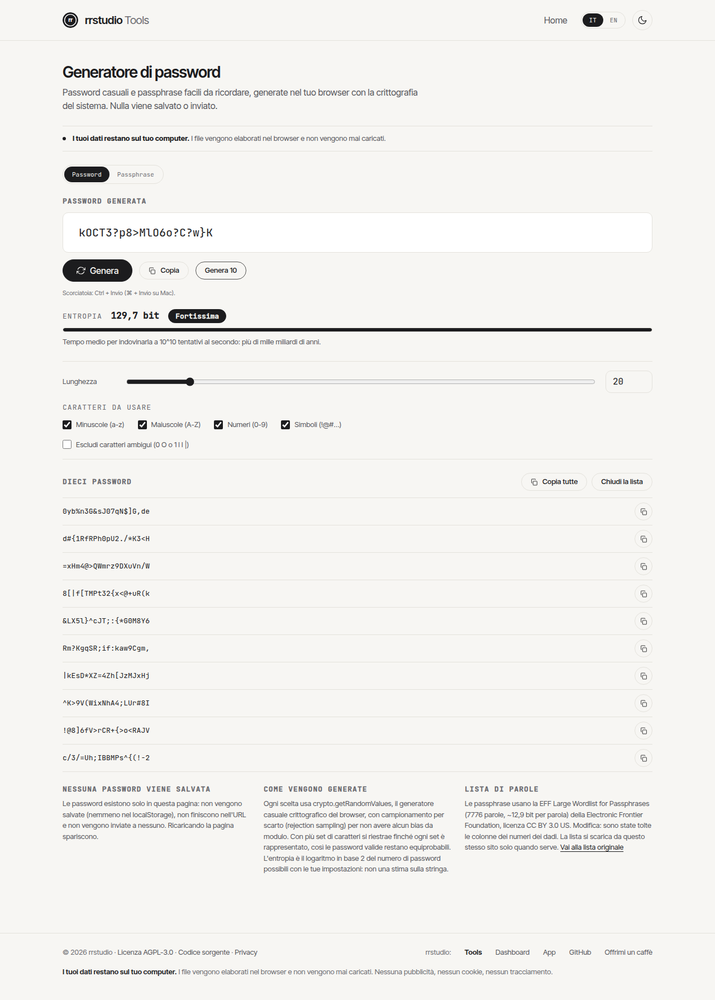

- Passwords of 4-128 characters from lowercase, uppercase, digits and symbols (at least one set always on), optional "exclude ambiguous characters" (`0 O o 1 l I |`) and a guarantee of at least one character per chosen set. Passphrases of 3-12 words with a separator, capitalisation and an optional number.
- Randomness only from `crypto.getRandomValues`, with rejection sampling (no modulo bias); unit tests check the absence of bias and the set guarantee.
- Entropy is the log2 of the real number of possible results (inclusion-exclusion for the set guarantee), with a bar, a label (weak < 50, fair < 80, strong < 110, very strong) and the average time to guess at 10^10 guesses/s. "Generate 10" gives a copyable list; Ctrl/Cmd + Enter generates.
- Nothing is stored (not even in `localStorage`). Passphrases use the [EFF Large Wordlist](https://www.eff.org/deeplinks/2016/07/new-wordlists-random-passphrases) (CC BY 3.0 US, dice numbers removed), a static file loaded from the same origin only when needed.

### JWT decoder

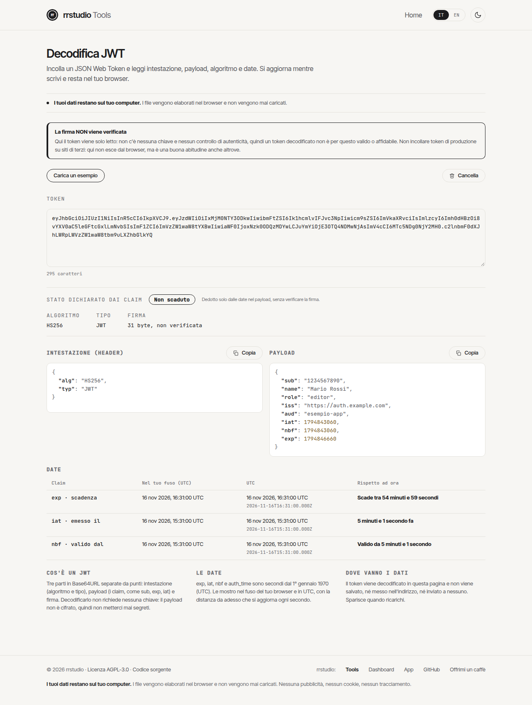

- Route `/jwt-decoder` (also `/en/jwt-decoder`). Accepts a leading `Bearer `, quotes and line breaks; decodes as you type.
- Header and payload as highlighted JSON with copy buttons; standard dates (`exp`, `iat`, `nbf`, `auth_time`) in the browser's time zone and in UTC, with a live distance from now. The status (expired, not yet valid) is only deduced from the dates.
- The signature is never verified and a prominent notice says so, with the advice not to paste production tokens into third-party sites. Nothing is stored or sent.

### UUID generator

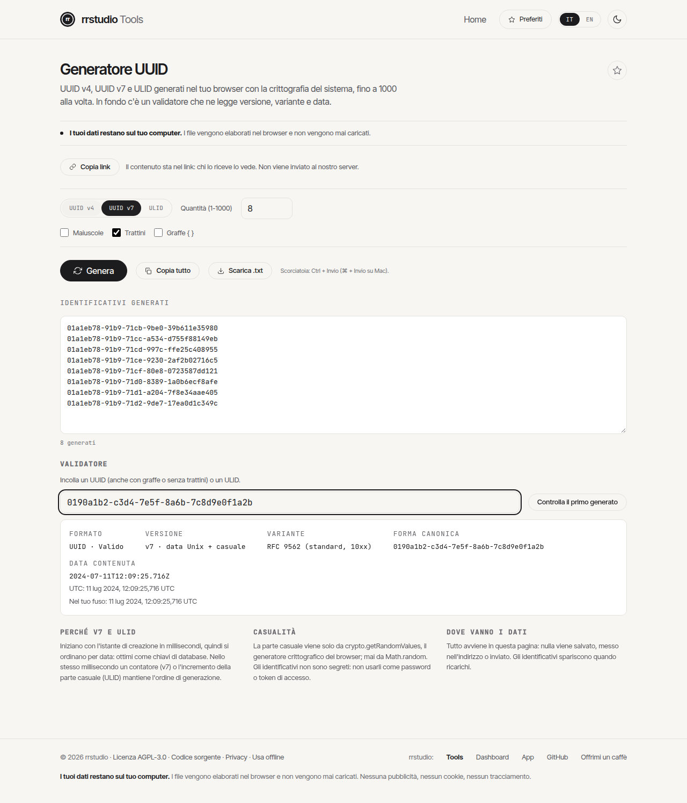

- Route `/uuid-generator`. UUID v4, UUID v7 (48-bit millisecond timestamp, 12-bit counter, so ids stay sorted within the same millisecond) and ULID (Crockford Base32, monotonic).
- Tests check format, version, variant, ordering of v7 and ULID, and known vectors. The validator reports version, variant and the embedded date.

### Fake data generator

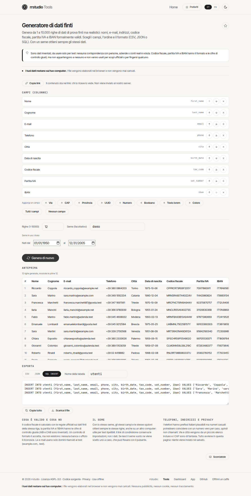

- Route `/fake-data-generator` (also `/en/fake-data-generator`). Everything is invented: names from short lists, emails only on reserved domains (`example.com`, `.test`), Italian-looking phone numbers, a small built-in list of cities with made-up ZIP codes. The page says clearly that the data is fake and for testing only.
- The tax code is computed with the real rules (reusing the Codice fiscale tool) on the fake data of the same row; the VAT number and the Italian IBAN reuse the validators' check-digit code, with invented ABI/CAB. Tests validate every generated value with the existing analyzers.
- A seed (any text) gives the same rows every time; with the seed empty a random one is chosen and shown, so it can be pinned. Generation runs in chunks of 500 rows, so 10,000 rows do not block the UI. Export: CSV (comma, semicolon or tab, RFC 4180 quoting), JSON, SQL `INSERT` (validated table name, escaped quotes). The share link keeps the settings, not the data.

### JSONPath, JSON → TypeScript, JSON Schema

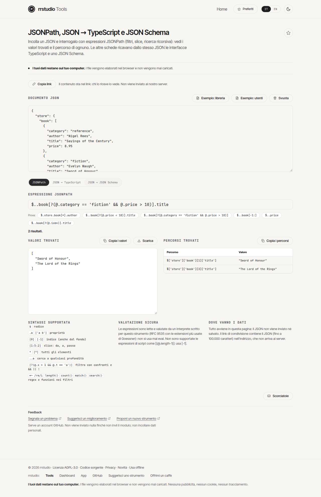

- Route `/json-query` (also `/en/json-query`). The JSONPath engine is a hand-written parser and interpreter (no `eval`, no `new Function`): selectors `$ . [] ['key'] * ..`, negative indexes, slices `[a:b:c]` (RFC 9535 algorithm), unions, filters with `== != < <= > >= && || !`, existence tests, `=~ /regex/flags` and the functions `length`, `count`, `match`, `search`, `value`. Script expressions like `[(@.length-1)]` are not supported (use `[-1]`).
- Safety: regexes are length-limited and nested quantifiers are rejected, a step budget stops explosive queries, results are capped at 5,000, and own properties only are read (no prototype lookups). Errors report the position in the expression; JSON errors report line and column.
- Tests follow the examples of Goessner's article and RFC 9535 (slice table, filter semantics), plus the TypeScript generator (PascalCase names, optional keys, unions, name collisions) and the JSON Schema generator.

### YAML / JSON / TOML converter

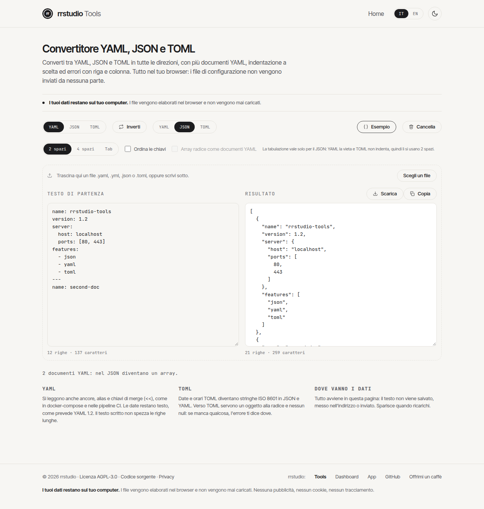

- Route `/yaml-json-converter`. Multi-document YAML becomes an array in JSON; TOML dates become ISO strings; TOML needs an object at the root and no `null` (the error says where). Tests cover all directions, error positions and `__proto__` keys.

### XML formatter

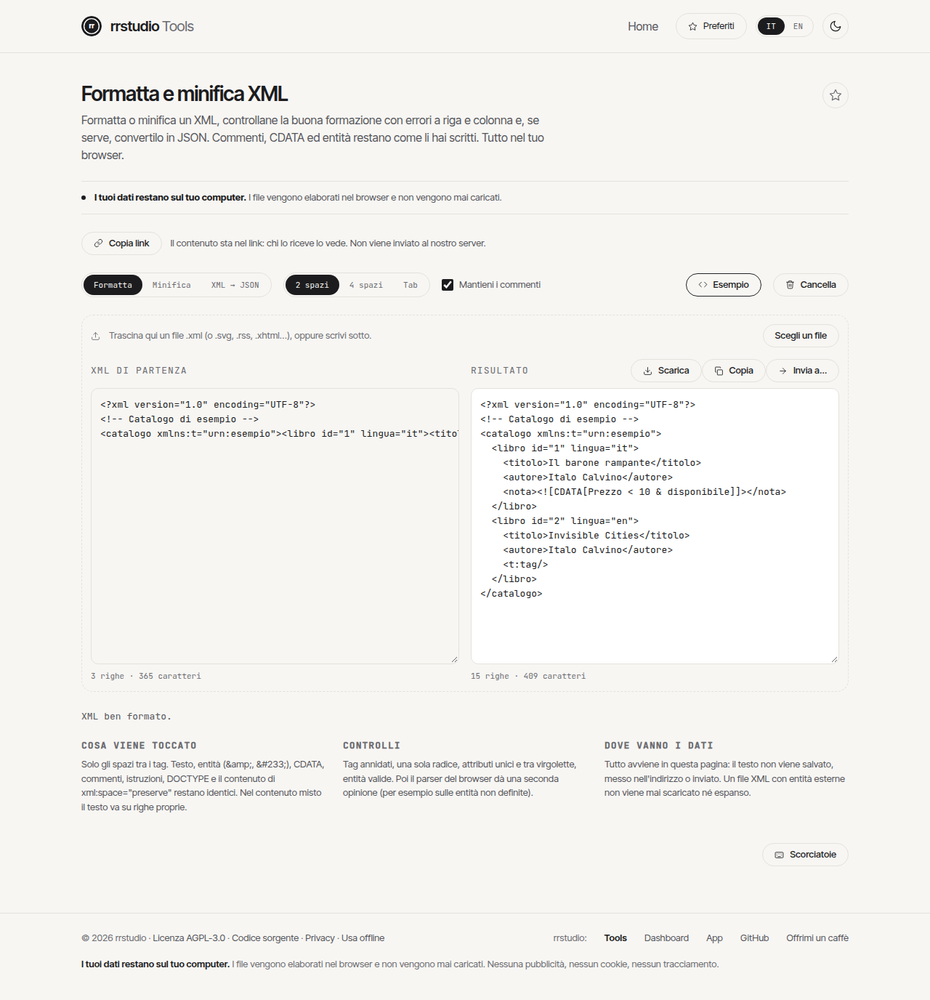

- Route `/xml-formatter`. Own tokenizer for formatting and well-formedness (exact line/column), DOMParser for the JSON conversion and as a second check. Entities are never expanded.

### SQL formatter

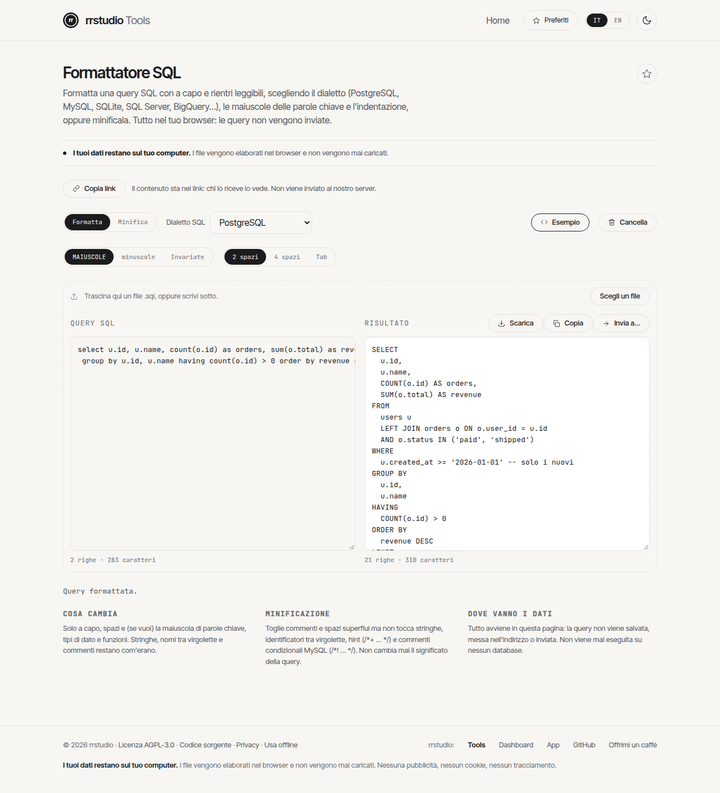

- Route `/sql-formatter`. Formatting by `sql-formatter`; the minifier is our own tokenizer aware of strings, quoted identifiers, comments, `$$` quoting and dialect specifics.

### HTML entities & escaping

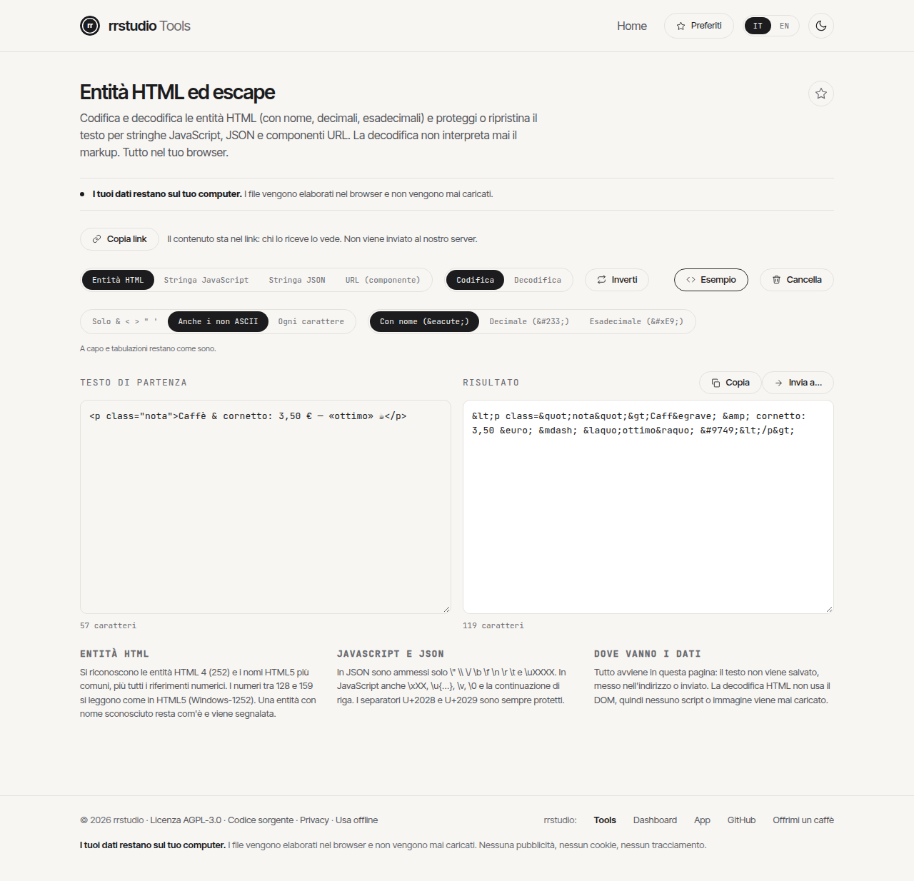

- Route `/html-entities`. HTML 4 entity table plus common HTML5 names; numeric references follow HTML5 (Windows-1252 for 128-159). Round-trip tests for every scope and format.

### Text case converter

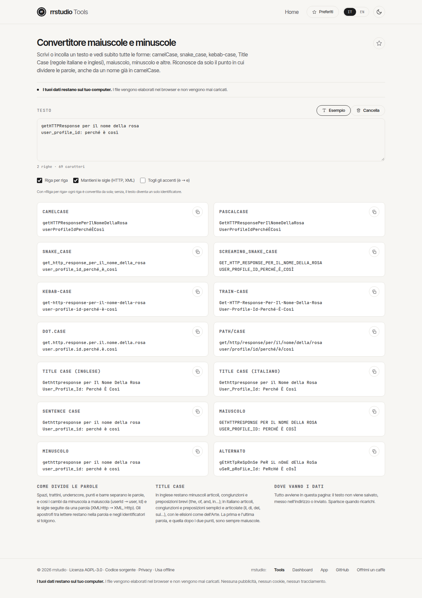

- Route `/case-converter`. Word splitting handles camelCase, acronyms (`XMLHttp`), digits, apostrophes and accents; Title Case has separate English and Italian rules.

### Slug generator

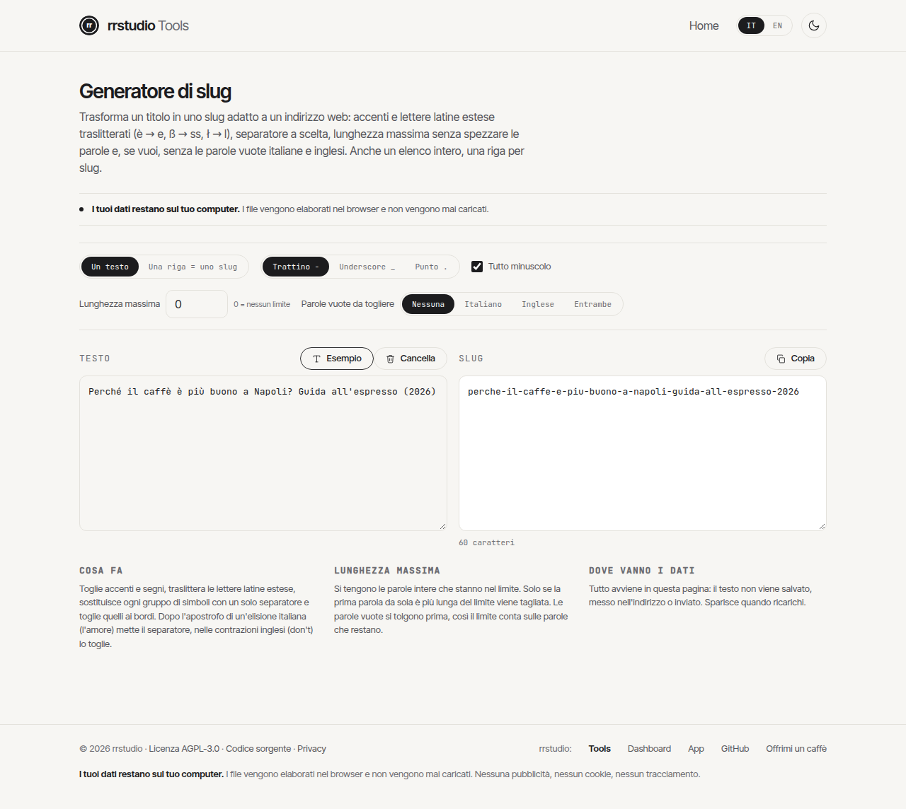

- Route `/slug-generator`. Shared transliteration helper in `src/app/shared/translit.ts`; the output is always `[a-z0-9]` words joined by the separator.

### Lorem ipsum generator

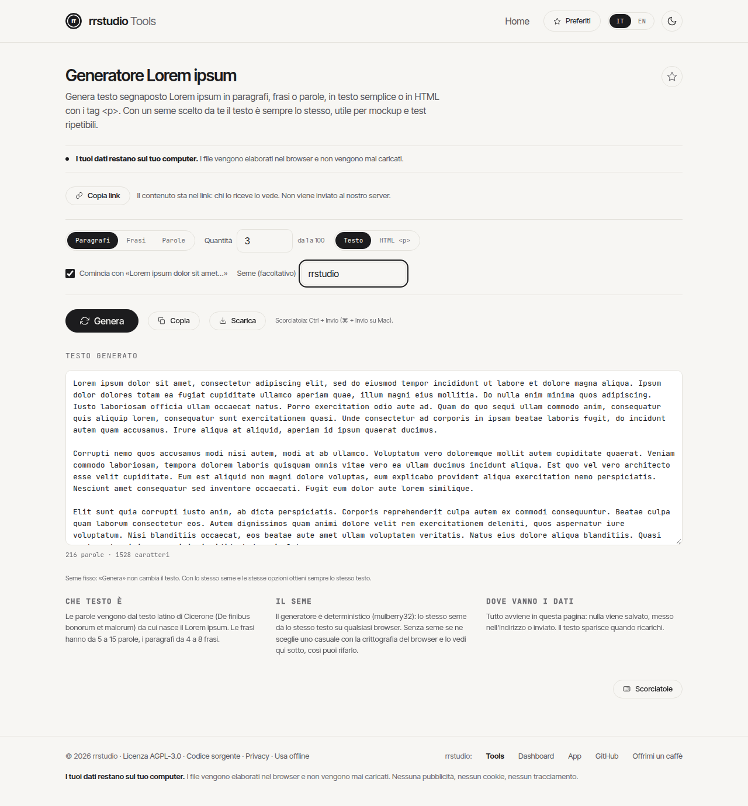

- Route `/lorem-ipsum-generator`. mulberry32 PRNG seeded by an xmur3 hash: same seed and options, same text in any browser.

### Cron expressions

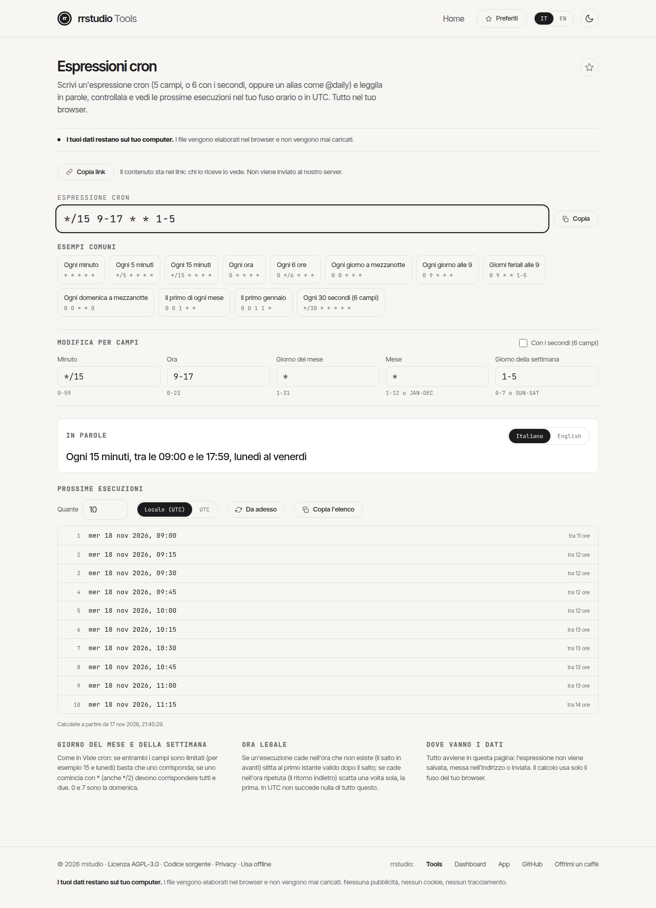

- Route `/cron-expression`. Next runs are computed by our own field-skipping algorithm over wall-clock time and mapped to instants with `Intl`; spring-forward gaps slip to the first valid instant, repeated hours run once. Tested on Europe/Rome and America/New_York.

### Unix timestamp converter


- Route `/timestamp-converter`. The unit is recognised from the magnitude (below 10^11 seconds, 10^14 milliseconds, 10^17 microseconds, otherwise nanoseconds) and can be forced; nanoseconds use BigInt.
- Time zones come from `Intl`; a local time that does not exist (clock jumps forward) or happens twice (clock goes back) is reported. Tests cover the 2026 changes in Europe/Rome and America/New_York. Supported years: 1 to 9999.

### Color contrast checker


- Route `/color-contrast-checker`. WCAG 2.x relative luminance and ratio, compared with the exact value (the displayed ratio is truncated, not rounded). A transparent background is composited on white, a transparent text on the background.
- The suggestion changes only the OKLCH lightness of the chosen color (chroma is reduced only to stay in the sRGB gamut) and checks the 8-bit result.

### Markdown editor

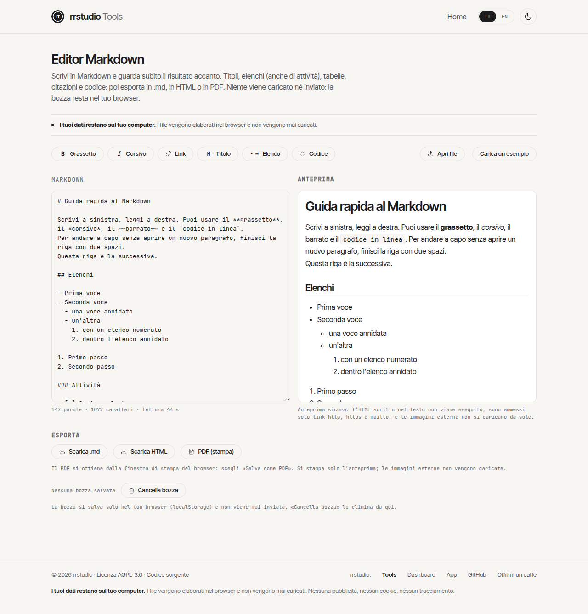

- Route `/markdown-editor` (also `/en/markdown-editor`). Own parser (CommonMark + GFM essentials), tested on representative cases and fuzzed.
- Safety: raw HTML is shown as text, links are limited to http, https, mailto and relative, external images are shown as a clickable placeholder and never loaded automatically.
- Toolbar and shortcuts (Ctrl+B/I/K), export to `.md`, standalone HTML and PDF through the print dialog (dedicated print style). The draft is saved in `localStorage` only, with a "clear draft" button.

### Word & character counter


- Route `/word-counter` (also `/en/word-counter`). Characters are grapheme clusters (`Intl.Segmenter` where available), so emoji and accents count 1.
- Frequent words with automatic or chosen Italian/English stopword exclusion; limits show how many characters are left or over; case conversions with undo.

### Regex tester

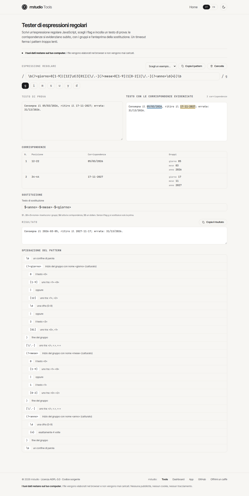

- Route `/regex-tester` (also `/en/regex-tester`). Matching runs in a Web Worker that is terminated after 1 second, with a clear message; syntax errors show the engine message.
- Matches with index and groups (named too), replacement preview, token explanation (Italian/English) and examples: email, URL, date, Italian postal code, codice fiscale, IBAN.

### Text compare (diff)

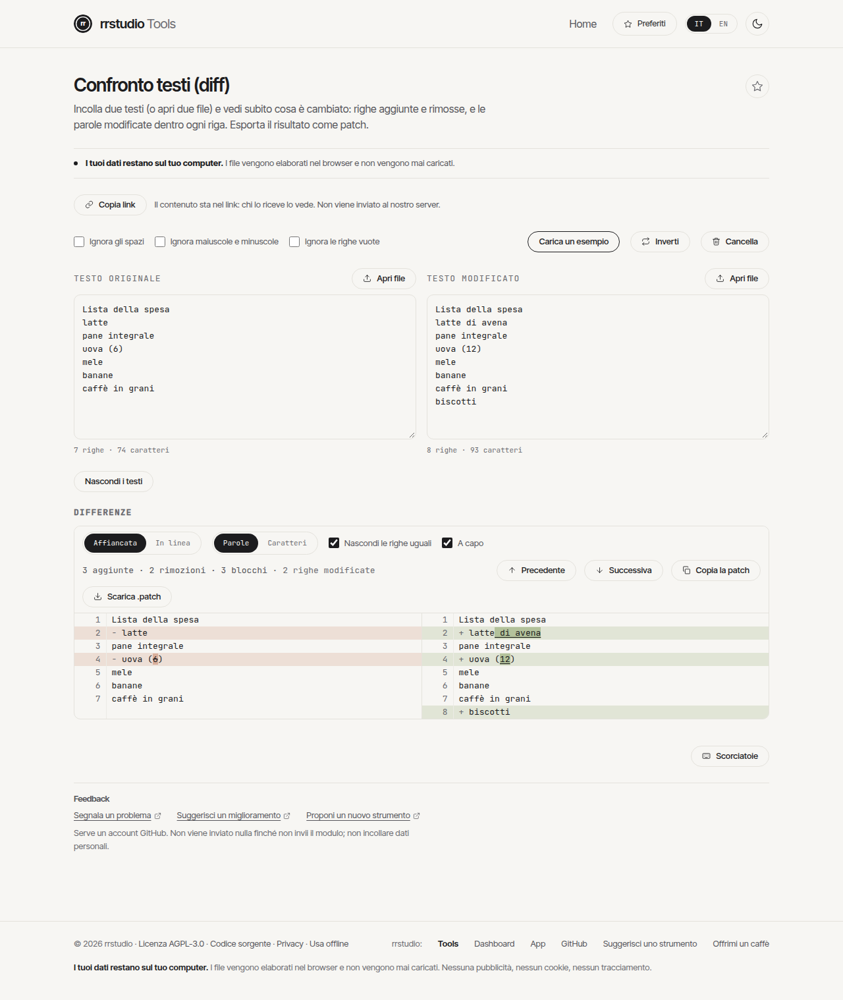

- Route `/text-diff` (also `/en/text-diff`). Two text areas (or open two files), comparison by lines with the Myers O(ND) algorithm in its linear-space form, run in a Web Worker so two 5,000-line texts do not freeze the page.
- Changed lines are refined by word or by character; side-by-side or inline view, unchanged lines collapsed with a three-line context, counts of additions and removals, previous/next difference navigation.
- Options: ignore whitespace, case and blank lines. Export as a unified diff (`.patch`) or copy it.

### Hash & checksum


- MD5, SHA-1, SHA-256, SHA-384, SHA-512 of a text (live) or a file up to 2 GB read in blocks with `file.stream()`, with a progress bar and cancel; hex (optionally uppercase) and Base64, each copyable.
- SHA-1/256/384/512 use Web Crypto, which needs the whole buffer: up to 500 MB the file is assembled in memory. Above that, a warning appears and only MD5 and SHA-256 are computed, incrementally, by pure TypeScript implementations tested against the official vectors and Web Crypto.
- MD5 is not in Web Crypto (it is considered broken): it is implemented in TypeScript (RFC 1321 vectors) and flagged, like SHA-1, as not secure for cryptography.
- "Compare with a checksum": paste an expected hash (case and spaces ignored) and the matching algorithm is highlighted, or you get "No match".

### URL Encode/Decode


- `encodeURIComponent` (component) or `encodeURI` (full URL), with "space as +" for form-urlencoded data.
- Clear errors on invalid `%` sequences; a table with protocol, host, path, hash and each decoded query parameter.

### JSON Viewer & Editor


- Tree view with lazy rendering and 100-children pages, so files up to 50 MB open without freezing the page; ARIA tree keyboard navigation.
- Search by key or value with next/previous, path as `$.users[0].name` and as JSON Pointer `/users/0/name`.
- Inline editing with type validation, key rename, add, delete, duplicate, move, change type; undo/redo (Ctrl/Cmd+Z); Tree and Text views.

### JSON Formatter and Validator


- Format, minify, sort keys recursively; copy, download as `.json` or load a `.json` file by drag & drop.
- Line numbers with the error line marked; line and column are worked out for V8/Chromium, Firefox and Safari messages.
- Hand-made syntax highlighting (no editor library, no `innerHTML`).

### Percentage calculator

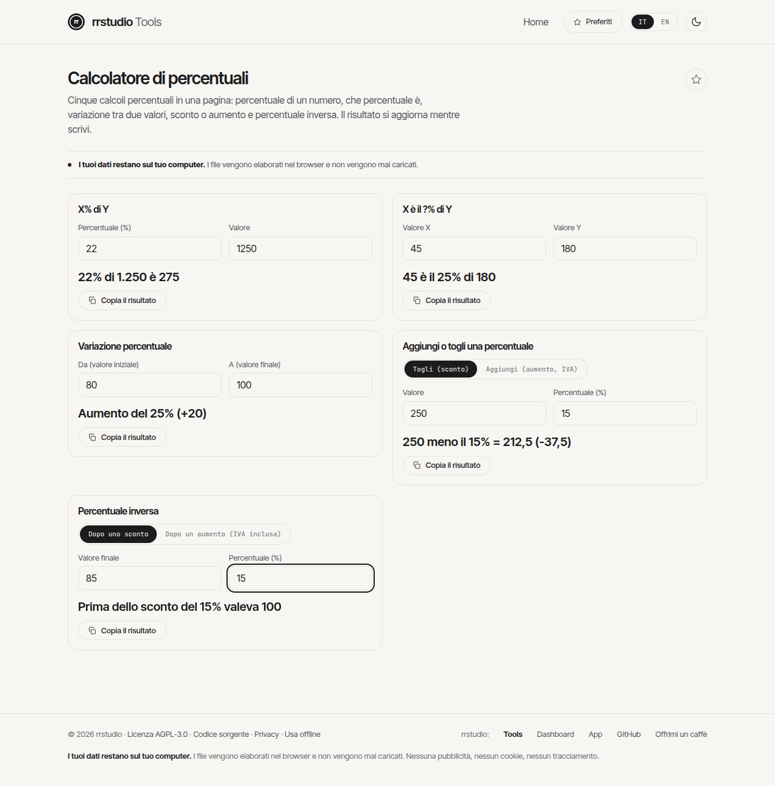

- Route `/percentage-calculator` (also `/en/percentage-calculator`). Five cards, each with its own two fields and a live sentence as the result. Both decimal conventions are accepted ("12,5" and "12.5").
- Percentage change uses the absolute value of the starting value, so going from -50 to -25 is an increase. Percentages above 100%, negative numbers and the impossible cases (division by zero, reversing a 100% discount) are covered by tests.

### Unit converter

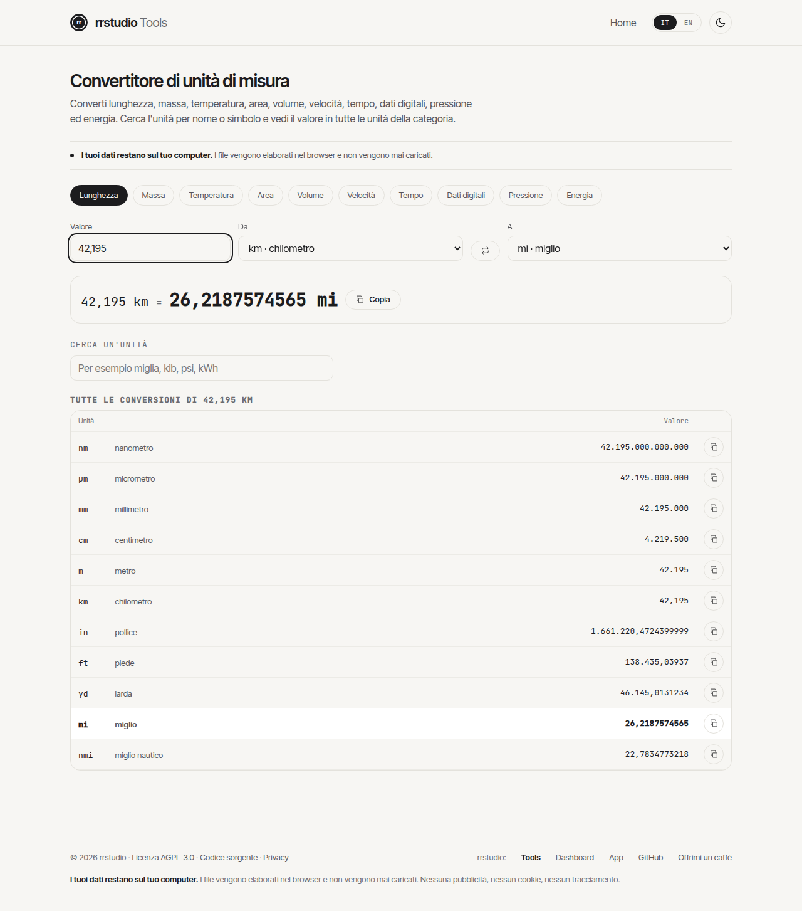

- Route `/unit-converter` (also `/en/unit-converter`). Ten categories with exact definitions (international yard and pound, NIST volumes). Digital data lists SI units (kB, MB, GB…) and binary ones (KiB, MiB, GiB…) side by side. Month and year are averages.
- The search box matches symbols, names in the current language and common aliases (`mq`, `kmh`, `inch`) in every category and jumps to the unit. The table shows the value in all units of the category, each with a copy button. Tests check every pair of units of every category for a round trip.

### Date and age calculator

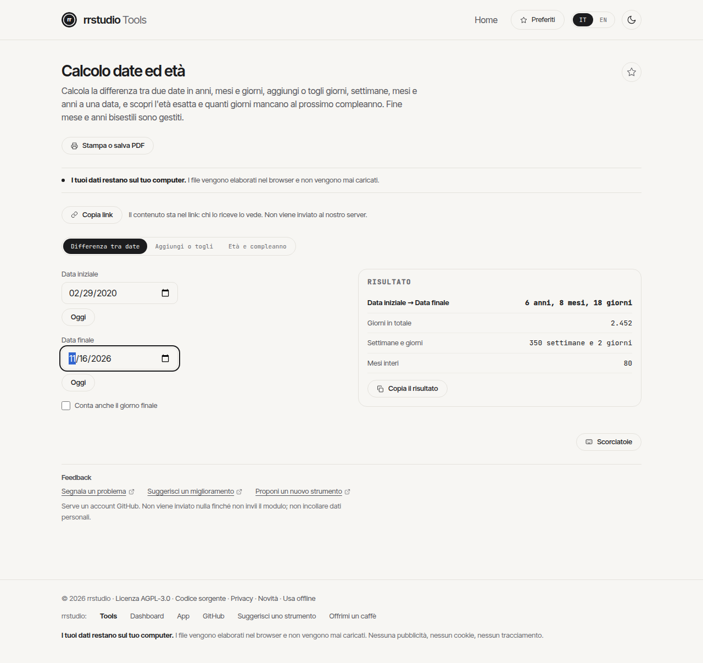

- Route `/date-calculator` (also `/en/date-calculator`). Dates are plain year-month-day values counted with a day number: no time zone or daylight saving can shift a result.
- Month-end rule: adding months clamps to the last day (31 January + 1 month = 28/29 February); the difference counts whole months that fit, then the remaining days (31 January to 1 March = 1 month and 1 day). Born on 29 February: the birthday is celebrated on the 28th in non-leap years.

### Time zone converter

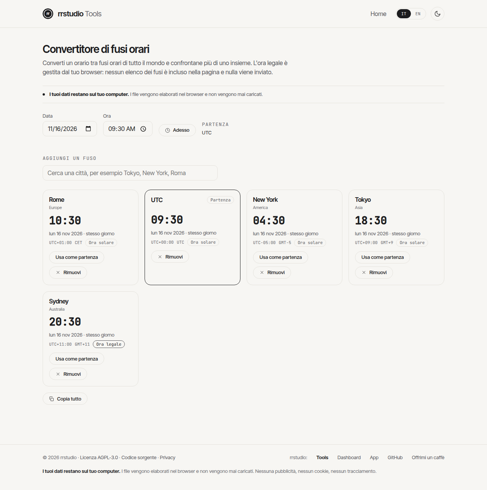

- Route `/timezone-converter` (also `/en/timezone-converter`). No time zone database is bundled: the list comes from `Intl.supportedValuesOf('timeZone')` and offsets from `Intl.DateTimeFormat`, so results follow the browser's own tz data.
- Several zones are shown together; any card can become the source (the instant stays the same). Local times that do not exist (spring forward) or happen twice (fall back) are detected and reported. Search matches IANA city names, a few Italian and English common names and the localized zone names.

### Number base converter

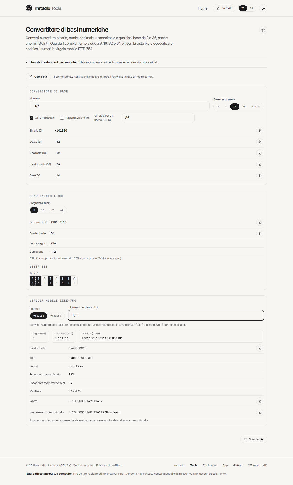

- Route `/number-base-converter` (also `/en/number-base-converter`). BigInt conversion between any bases 2-36 (prefixes `0x`, `0b`, `0o`, separators and negatives accepted), copy per row.
- Two's complement at 8, 16, 32 and 64 bits shows the pattern, hex and both readings (signed/unsigned) with a bit view split by byte. IEEE-754 float32/float64: type a number to encode it or a `0x…`/`0b…` pattern to decode it; sign, exponent and mantissa fields, class (normal, subnormal, zero, infinity, NaN) and the exact decimal value of the stored number, computed with BigInt.

### chmod calculator

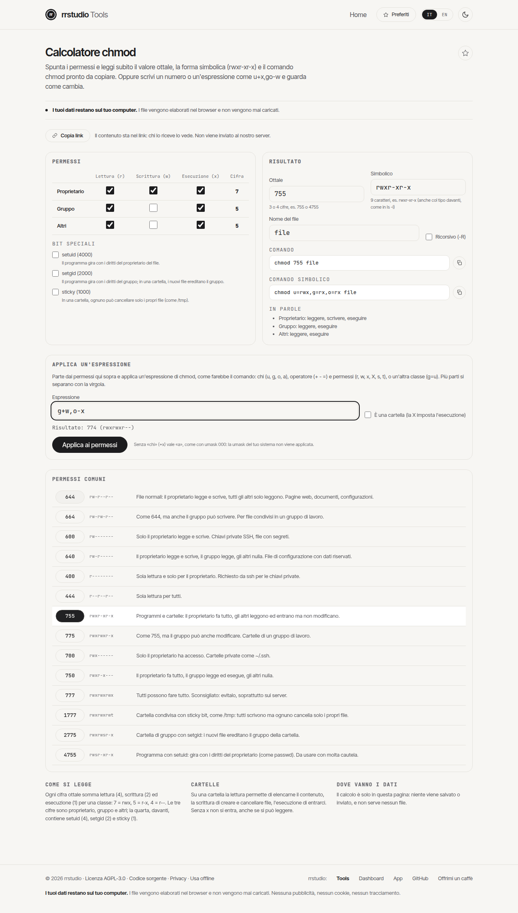

- Route `/chmod-calculator` (also `/en/chmod-calculator`). The permission is a number 0-07777; checkboxes, octal, symbolic and the command are views of it. Symbolic input accepts 9 characters or 10 with the file type (`-rwxr-xr-x`), with `s`/`S`/`t`/`T`.
- Expressions follow `chmod`: `ugoa`, `+ - =`, `rwxXst`, copying a class (`g=u`), several clauses with commas; `=` also clears setuid/setgid. No umask is applied. Tests round-trip all 4096 permissions.

### CSS unit converter

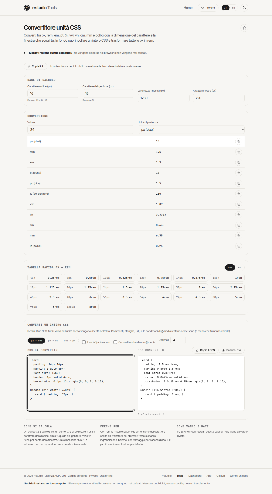

- Route `/css-unit-converter` (also `/en/css-unit-converter`). 1 in = 96 px, 1 pt = 1/72 in; rem uses the root font size, em and % the parent's, vw/vh the viewport you set.
- The bulk converter rewrites `px` (or `rem`/`em`) values in pasted CSS, skipping comments, strings, `url()` and `@media` conditions (optional), with an option to keep `1px` hairlines.

### CSS generator

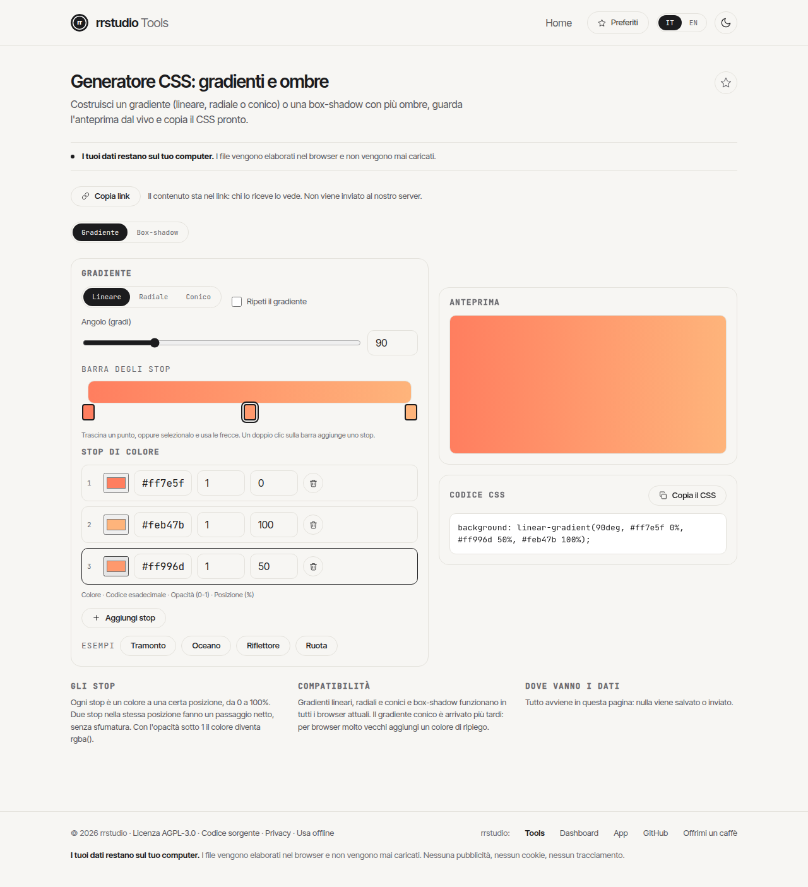

- Route `/css-generator` (also `/en/css-generator`). Two tabs: gradient (linear/radial/conic, up to 12 stops dragged on a bar with pointer or arrow keys, or typed, opacity, angle, center, repeating) and box-shadow (up to 8 layers, inset).
- Colors become `#rrggbb`, or `rgba()` when not opaque. The preview is a styled element built from validated numbers and hex colors.

### SVG optimizer

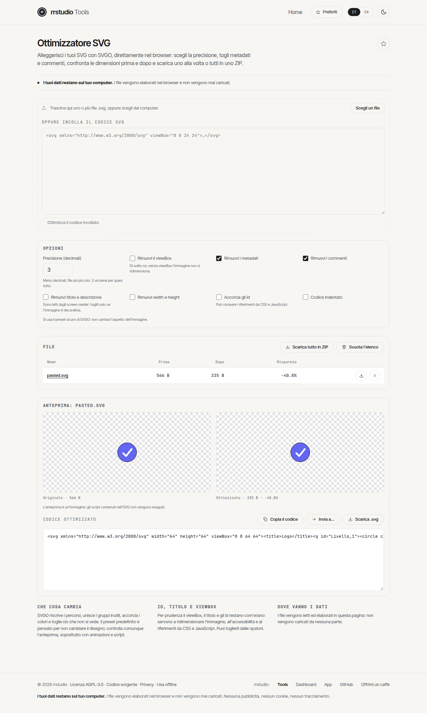

- Route `/svg-optimizer` (also `/en/svg-optimizer`). Runs [SVGO](https://github.com/svg/svgo) (browser build, lazy-loaded) with its default preset and `multipass`; the viewBox, title and ids are kept unless you opt out.
- The preview uses `` with a `data:` URL, so scripts inside an SVG never run and nothing is injected into the DOM. Several files are listed with before/after sizes and can be downloaded one by one or as a ZIP ([fflate](https://github.com/101arrowz/fflate)).

### Favicon generator

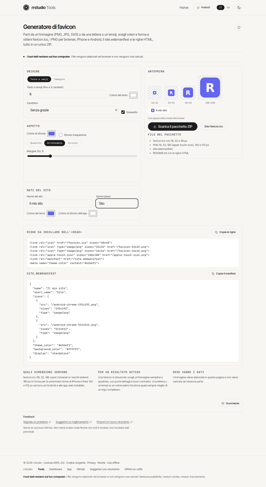

- Route `/favicon-generator` (also `/en/favicon-generator`). Source: an image (square crop or fit, padding, zoom) or 1-3 characters/emoji. Shapes: square, rounded, circle; transparent or solid background.
- `favicon.ico` is written by a small encoder (ICO container with embedded 16/32/48 PNGs); the ZIP also holds the PNGs, `site.webmanifest` and a README with the HTML lines.

### .htpasswd generator

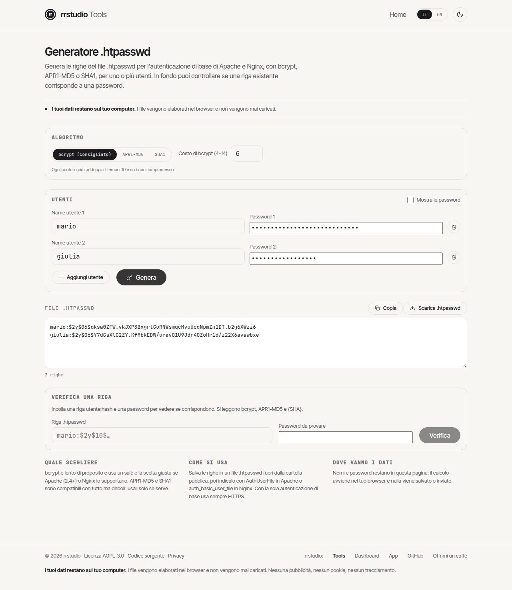

- Route `/htpasswd-generator` (also `/en/htpasswd-generator`). bcrypt via [bcryptjs](https://github.com/dcodeIO/bcrypt.js) (`$2y$` prefix, cost 4-14) in a Web Worker; APR1-MD5 implemented here (MD5 from the hash tool) and `{SHA}` via Web Crypto.
- Tests compare APR1 with `openssl passwd -apr1 -salt …` vectors and bcrypt with an hash produced by another implementation. The checker reads bcrypt, APR1 and `{SHA}` lines.

### Certificate decoder

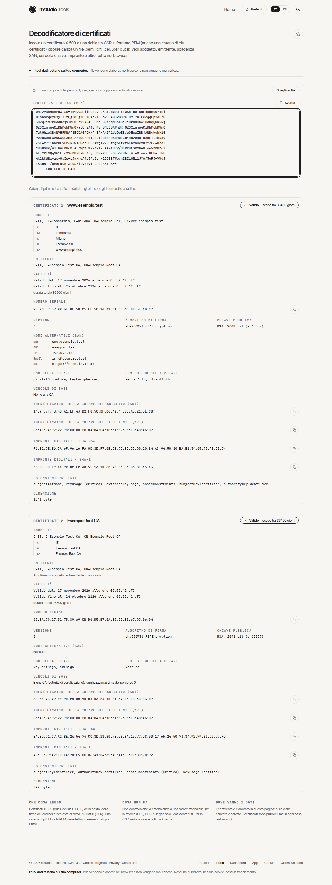

- Route `/certificate-decoder` (also `/en/certificate-decoder`). Built on [PKI.js](https://pkijs.org) and [ASN1.js](https://github.com/PeculiarVentures/ASN1.js), loaded on demand. Reads PEM (one or many blocks), base64 without headers, or DER files; private keys are refused with a warning.
- Tests use fixtures generated with OpenSSL (RSA and EC chains, Ed25519, expired, CSR) and compare serials, SKI/AKI and fingerprints with OpenSSL's output. It does not validate the chain or revocation.

### Meta tag preview

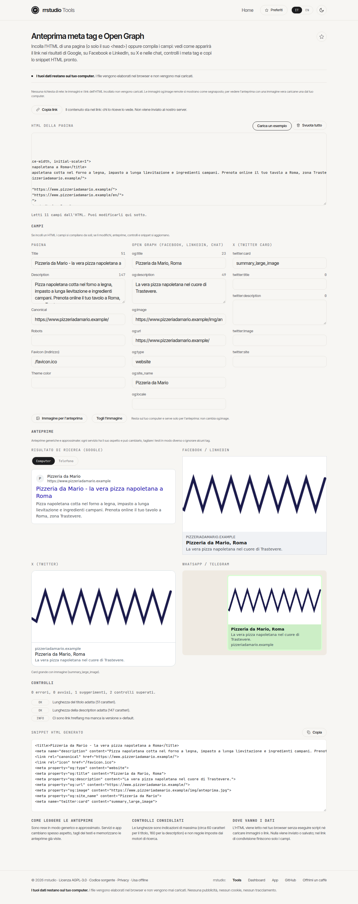

- Route `/meta-tag-preview` (also `/en/meta-tag-preview`). The pasted HTML is parsed with `DOMParser`: the resulting document has no browsing context, so no script runs and no image, stylesheet or link is loaded (the e2e test pastes HTML full of external URLs and fails on any network request). Remote `og:image` URLs are never downloaded: the previews show a placeholder with the URL, and a local image can be loaded just for the preview.
- Previews are generic and approximate (Google result desktop/phone, Facebook/LinkedIn, X summary and large card, WhatsApp/Telegram) and use the same fallbacks the services use (`og:title` → `title`, `twitter:*` → `og:*`). Checks: recommended lengths, missing title/description/`og:image`/canonical, relative or `http://` image URLs, invalid `twitter:card`, `noindex`, duplicate tags, invalid hreflang and missing `x-default`. The snippet generator escapes attribute values and round-trips through the parser (tested). The share link keeps the fields, not the pasted HTML.

### Sign a PDF

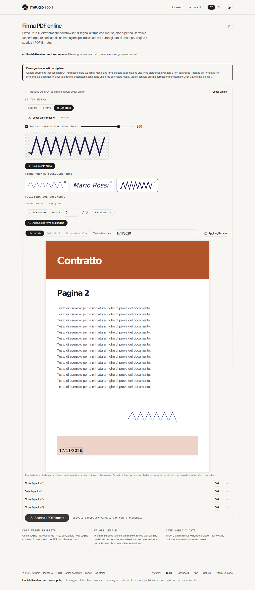

- Route `/pdf-sign` (also `/en/pdf-sign`). Pages are rendered with pdf.js (same loader as the PDF tools); the signature is embedded with `pdf-lib` as a transparent PNG. Placements are stored as fractions of the page as seen on screen and converted to PDF coordinates taking the page rotation and CropBox origin into account (unit-tested for the four rotations). Signatures are made by drawing (pointer events, pen pressure, undo), typing (system italic fonts, nothing downloaded) or from an image (optional white-to-transparent threshold, auto-trim).
- Several signatures and dates on several pages, drag and corner handle or keyboard (arrows, `+`/`-`, `Delete`), "copy to all pages". Password-protected or encrypted PDFs are refused with a clear message. A prominent notice says this is a graphic signature, not a digital or qualified one. The e2e test reads the produced PDF with `pdf-lib` and checks the image is on the right page.

### Crop images

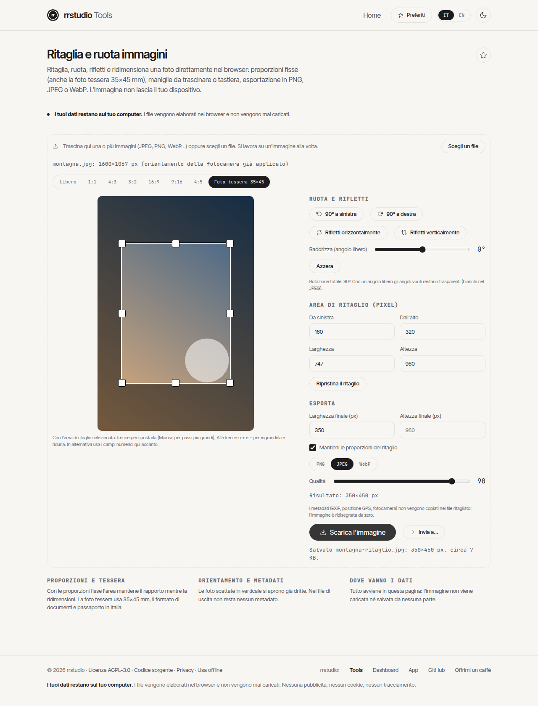

- Route `/image-crop` (also `/en/image-crop`). Crop rectangle with eight draggable handles and keyboard control (arrows to move, Alt+arrows or `+`/`-` to resize) plus numeric fields; fixed aspect ratios keep the shape from every handle (unit-tested). Rotation is the 90° steps plus a free angle (-45° to 45°) and flips; the enclosing box keeps the whole image, empty corners are transparent (white in JPEG).
- EXIF orientation is applied on decode and no metadata is copied: the output is redrawn from scratch and exported as PNG, JPEG or WebP (an error is shown if the browser cannot encode WebP). Resizing locks the proportions of the crop. The e2e test checks the dimensions of the downloaded PNG.

### Password strength checker

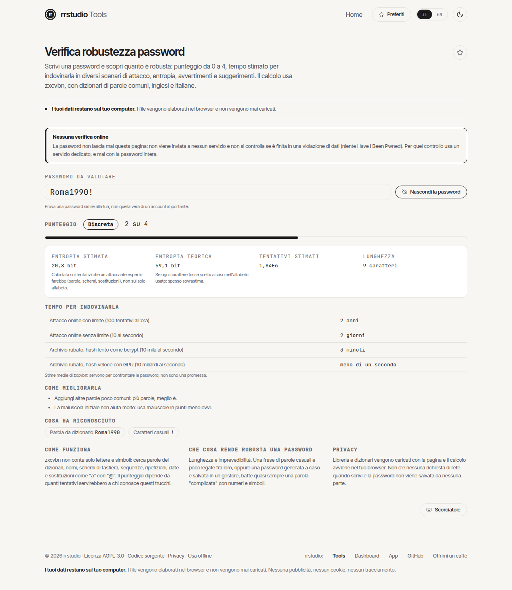

- Route `/password-strength-checker` (also `/en/password-strength-checker`). `@zxcvbn-ts/core` with the common, English and Italian dictionaries, all loaded with a dynamic import only on this page; the Levenshtein matcher is off to keep the check fast.
- Score 0-4, estimated entropy (log2 of the guesses) next to the theoretical one, estimated guesses and the time to crack in four scenarios (online throttled, online unthrottled, slow and fast offline hash). Warnings and suggestions are translated into Italian and English from the library keys.
- There is no online lookup and no Have I Been Pwned request: the password stays in the page. Passwords over 128 characters are truncated for the analysis.

### TOTP generator

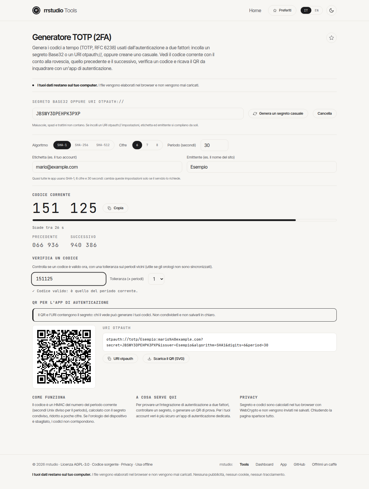

- Route `/totp-generator` (also `/en/totp-generator`). Paste a Base32 secret or an `otpauth://totp/` URI (settings, label and issuer are filled in), or generate a random 160-bit secret.
- SHA-1, SHA-256, SHA-512, 6-8 digits, period 5-300 s. Shows the current code with a countdown and the previous and next ones; verifies a typed code with a window of ±0-5 periods and says which period it belongs to.
- The otpauth URI and its QR (using the QR encoder of the QR generator) can be copied or downloaded. HMAC is computed with WebCrypto; the tests use the RFC 4226 and RFC 6238 vectors.

### Encrypt and decrypt files

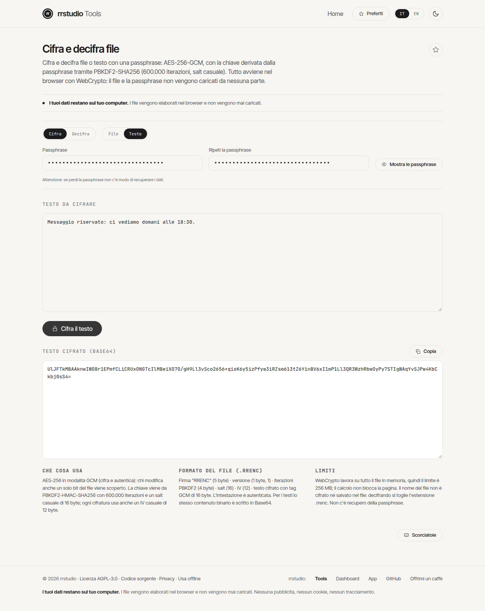

- Route `/file-encrypt` (also `/en/file-encrypt`). Files (up to 256 MB, the whole file is processed in memory by WebCrypto without freezing the page) or text, with a passphrase typed twice when encrypting.
- AES-256-GCM with a key from PBKDF2-HMAC-SHA256 (600,000 iterations, 16-byte random salt) and a random 12-byte IV. Format `.rrenc`: `RRENC` (5 bytes), version (1), iterations (4, big-endian), salt (16), IV (12), ciphertext and 16-byte GCM tag; the 38-byte header is authenticated data. Text uses the same bytes as Base64.
- A wrong passphrase and a tampered file give the same clear message (GCM cannot tell them apart); files declaring fewer than 600,000 iterations are refused. The passphrase is NFC-normalised. The file name is not stored: decrypting strips `.rrenc`.

### Barcode generator

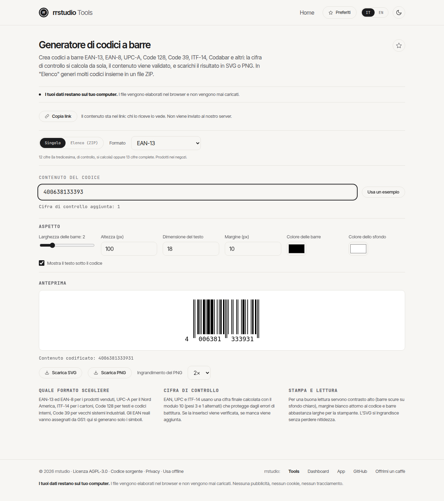

- Route `/barcode-generator` (also `/en/barcode-generator`). `jsbarcode`, loaded on demand: EAN-13, EAN-8, UPC-A, Code 128, Code 39 (optional modulo 43), ITF-14, ITF, Codabar, MSI and Pharmacode.
- Each format has its own validation; for EAN, UPC and ITF-14 the check digit is added when missing and verified when present (the error says which digit is expected). Options: bar width, height, text and size, margin, colours.
- Download as SVG or as PNG (1x to 4x); the bulk mode reads one value per line (up to 300), reports the lines with errors and builds a ZIP of SVG or PNG files with `fflate`.

### QR code reader

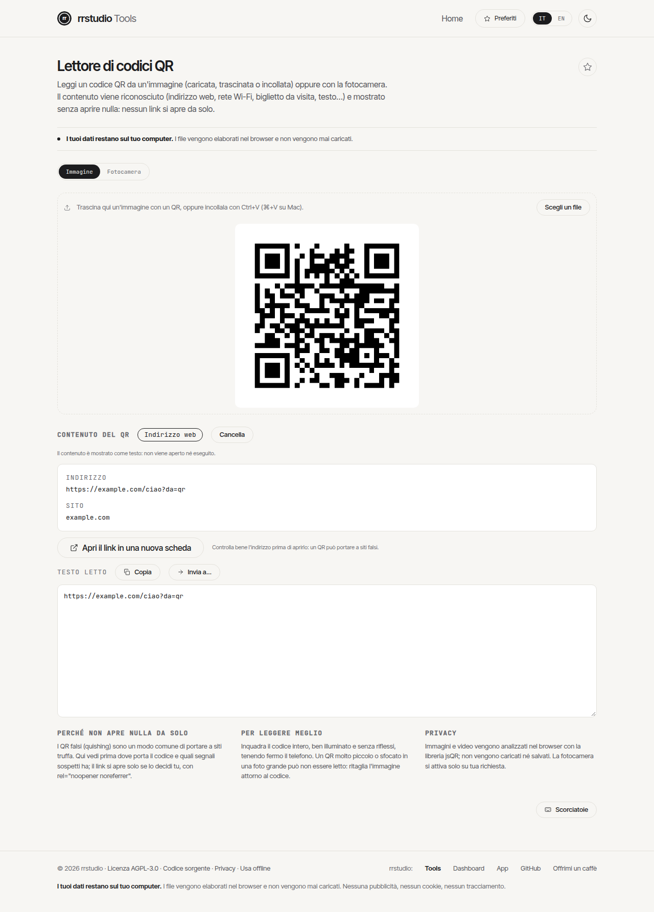

- Route `/qr-code-reader` (also `/en/qr-code-reader`). Reads an image chosen, dropped or pasted (`Ctrl+V`) with `jsQR`, trying several sizes so small codes inside big photos can be found, or the camera (`getUserMedia`) in a light loop at about 8 frames per second.
- The camera starts only after pressing the button and its tracks are stopped when a code is found, on Stop, when the tab goes to the background and when leaving the page.
- The content is classified (URL, Wi-Fi, vCard, email, phone, SMS, location, otpauth, calendar event, text) and shown as text. URLs get warnings (http, user name before `@`, punycode, IP address, shortener, unusual port) and open only through an explicit button with `rel="noopener noreferrer nofollow"`; `javascript:`, `data:` and other schemes are never linkable. Wi-Fi passwords are hidden until revealed.

### Sort lines

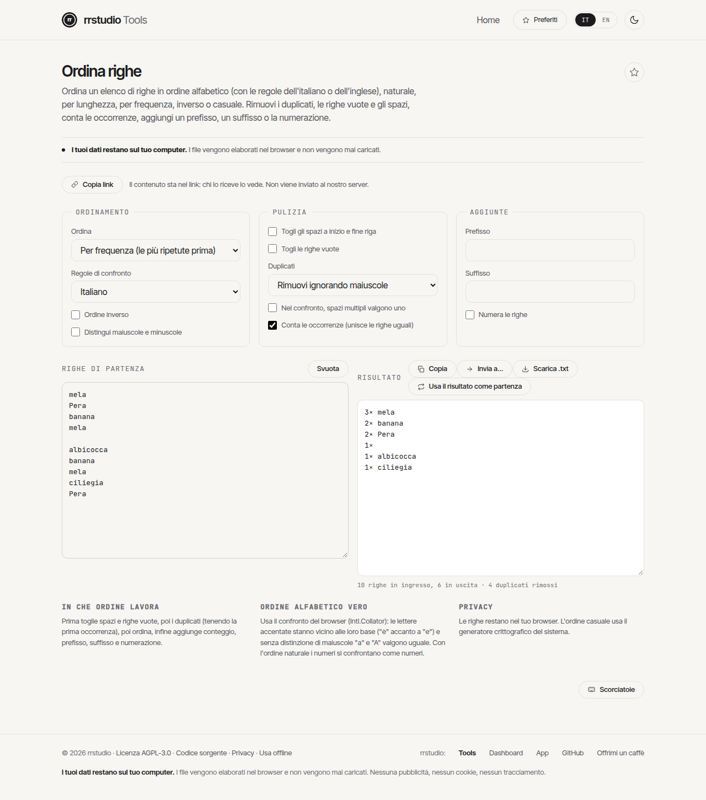

- Route `/sort-lines` (also `/en/sort-lines`). Alphabetical (`Intl.Collator` with Italian or English rules, with or without case), natural (`file2` before `file10`), by length, by frequency, reverse, random (Fisher-Yates with `crypto.getRandomValues`) or no sorting.
- Removes duplicates (identical, or ignoring case; spaces can be collapsed for the comparison), blank lines and spaces at the margins; counts occurrences (merging equal lines); adds prefix, suffix and numbering with a start and a separator. Shows how many lines were removed.

### Find and replace

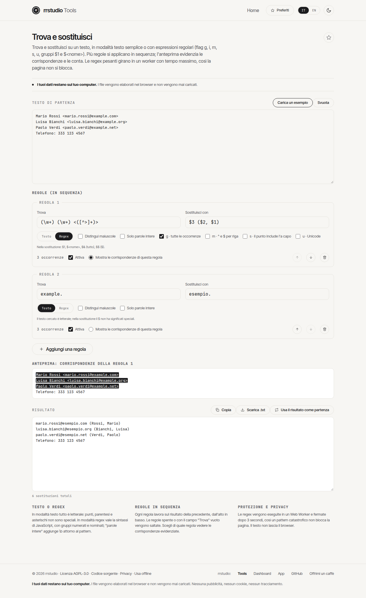

- Route `/find-replace` (also `/en/find-replace`). Plain-text mode (everything literal, `$` is not special) or regex mode (flags g, m, s, u; `$1`, `$<name>`, `$&`), case sensitivity and whole-word matching, up to 20 rules applied in sequence that can be turned off or reordered.
- A preview highlights the matches of the chosen rule on the text it receives, with a count for every rule; the final result can be copied, downloaded or reused as the source.
- Rules run in a Web Worker and are stopped after 3 seconds, so a catastrophic backtracking pattern cannot freeze the page.

### Text to speech

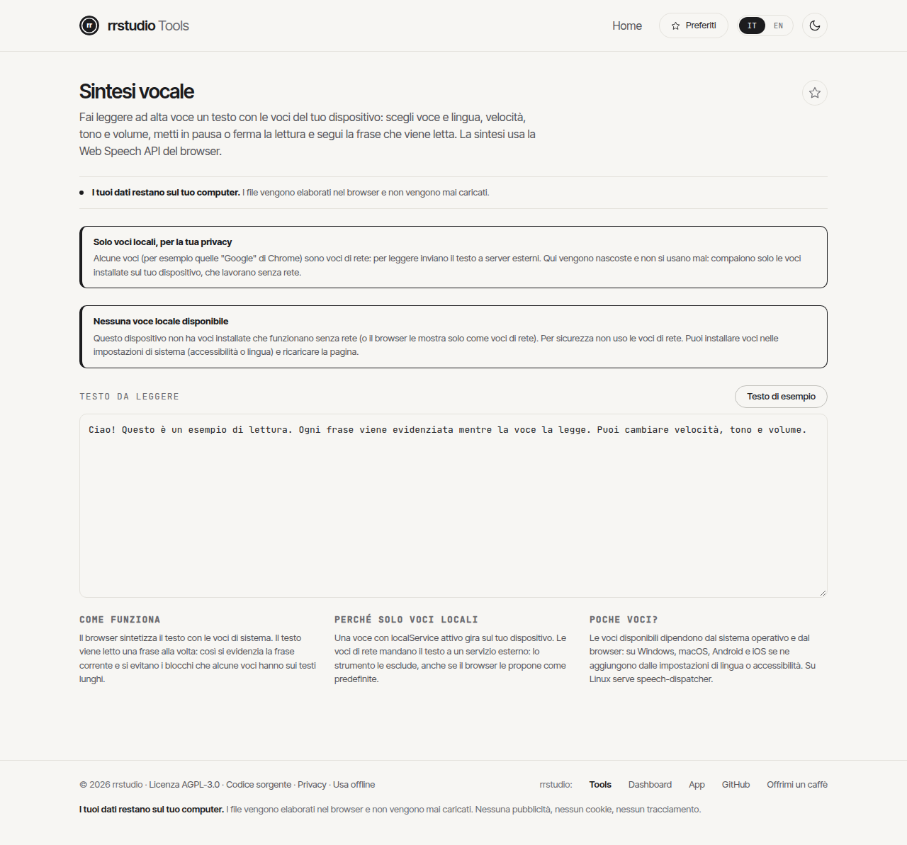

- Route `/text-to-speech` (also `/en/text-to-speech`). Web Speech API (`speechSynthesis`): voice and language, speed, pitch, volume, pause, resume and stop, with the sentence being read highlighted.
- Privacy: only voices with `localService === true` are listed and used (the utterance always gets an explicit local voice). Network voices, such as Chrome's "Google" ones, send the text to external servers and are hidden; if there is no local voice, or the API is missing, the page says so.

### Italian tax code (codice fiscale)

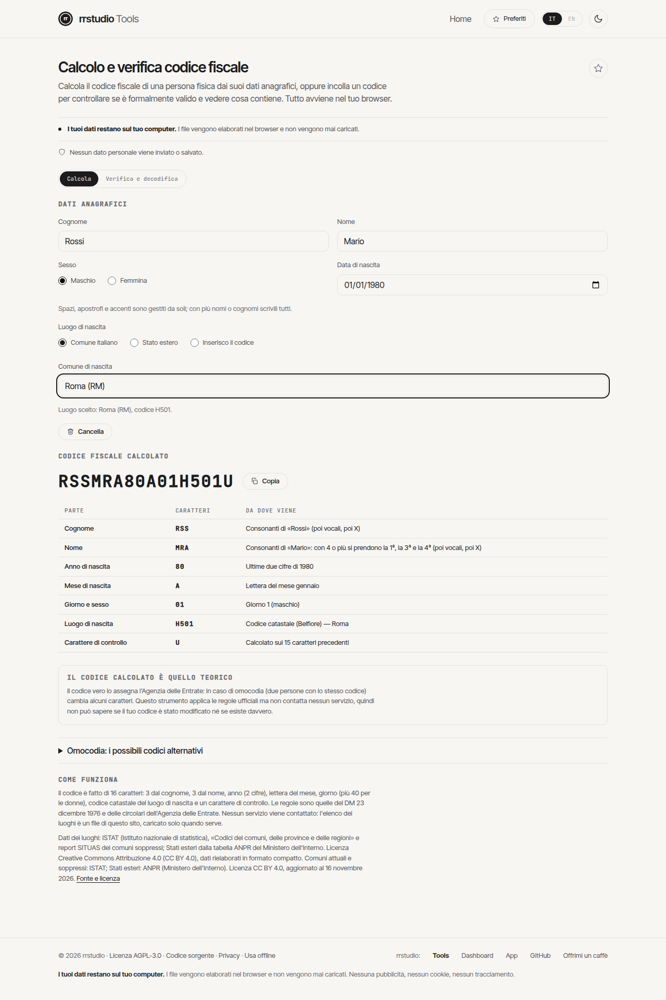

- Calculation with the official rules (surname and name consonants, the 1st/3rd/4th consonant rule for names, month letters, day + 40 for women, cadastral code, check character); accents, apostrophes, spaces and compound surnames are handled.
- Birth place: municipality with a type-ahead combobox (ARIA pattern), or the cadastral/Z code typed by hand.
- Check and decode: length, structure, check character, sex, birth date (most plausible century plus the alternative) and place; omocodia (letters LMNPQRSTUV in place of digits) is supported in both directions and the seven omocodia variants are listed.
- The result is the "theoretical" code: the real one is assigned by the Agenzia delle Entrate. Nothing is sent or stored.
- Place data: ISTAT "Codici dei comuni, delle province e delle regioni", CC BY 4.0, saved in `public/data/luoghi.json` (about 220 kB, 74 kB gzipped, loaded only when needed) by `node scripts/update-places.mjs`. Abolished municipalities and foreign countries (Z codes) have to be exported from ISTAT's SITUAS portal and passed with `--soppressi` and `--esteri` (see the script header); until then the Z code can be typed by hand.

### Italian e-invoice viewer (FatturaPA XML/P7M)


- Route `/fattura-elettronica`. Opens `.xml`, `.p7m` (CAdES, DER or Base64) and `.zip` files with several invoices. For `.p7m` a small ASN.1/DER reader (definite and indefinite lengths, fragmented OCTET STRINGs) extracts the XML from the CMS SignedData. **The signature is not verified**, and the page says so.
- Formats FPR12 (private parties), FPA12 (public bodies) and FSM10 (simplified), namespaces with or without prefix, several bodies per file. XML is read with `DOMParser` (no external stylesheets).
- Shows parties, general data (document type TD01-TD29, number, date, currency, reason, withholding, stamp duty, social security fund), references (orders, contracts, DDT), lines (quantity, price, discounts, VAT rate, nature N1-N7), VAT summary, totals and payment (terms, method MP01-MP23, due dates, IBAN). Code tables in Italian and English follow the public FatturaPA technical specifications, version 1.9.
- Attachments (Base64) are listed with name, format and size and can be downloaded. Print / save as PDF uses a dedicated print style with only the invoice; the XML extracted from a `.p7m` can be downloaded; the key details can be copied.

### VAT, VAT extraction & withholding tax (Italian)


- Route `/calcolo-iva`, Italian only (`italyOnly`). Four modes: add VAT, extract VAT from a gross amount, freelancer invoice (notula), and the reverse (from the net you want to receive to the fee to invoice).
- Invoice: 4% INPS surcharge, pension fund (2%, 4%, 5% or your own, with or without VAT), VAT 22/10/5/4/0% with the exemption nature code, 20% withholding on the fee or on fee plus fund, 2 € stamp duty above 77.47 € on operations without VAT, flat-rate regime (no VAT, no withholding, with the legal notes to print). A copyable invoice-style summary.
- All amounts are integer cents and rates are in basis points: no floating-point errors, rounding to the cent. The tests include hand-checked cases. It is an indicative tool, not tax advice; rules and rates are those of 2026.

### Working days calculator (Italian)


- Route `/calcolo-giorni-lavorativi`, Italian only (`italyOnly`). Between two dates (end date included or not) or add/subtract N working days.
- National holidays with Easter computed by the Gauss/Meeus algorithm (tested 2024-2030), optional patron saint of the regional capitals (indicative list, to be verified with the municipality) and one custom date.

### Withholding tax calculator (Italian)

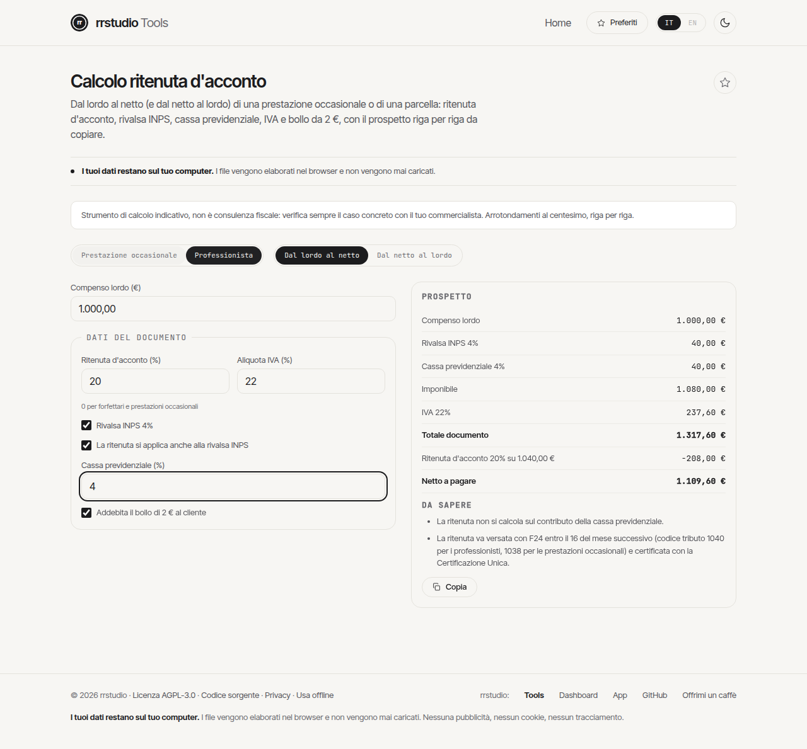

- Route `/calcolo-ritenuta-acconto`, Italian only (`italyOnly`). Two presets (occasional service, freelancer) that only pre-fill the fields, and two directions: from the gross fee to the net, or from the net you want to cash to the gross fee.
- Withholding rate (default 20%), 4% INPS surcharge, pension fund (any percentage, never subject to withholding), VAT (0 for flat-rate and occasional work), 2 € stamp duty on operations without VAT above 77.47 € with the choice to charge it to the client. A copyable statement lists every line.
- Integer cents with half-up rounding on each line. From net to gross the tool searches the cent-exact fee and, near the stamp duty threshold where the exact net does not exist, picks the closest. Tests cover hand-checked cases. Indicative only, not tax advice.

### Mortgage payment calculator (Italian)

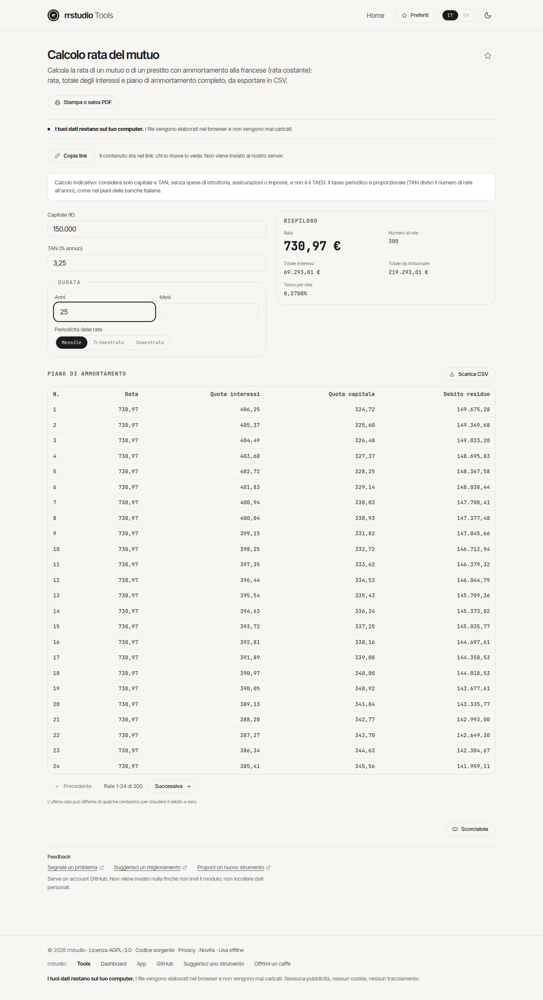

- Route `/calcolo-rata-mutuo`, Italian only (`italyOnly`). French amortization (constant payment): periodic rate is the TAN divided by the payments per year (the banks' proportional rate), computed with `expm1`/`log1p` so tiny rates stay stable; TAN 0% gives equal payments.
- Interest of each payment is rounded to the cent and the last payment absorbs the difference, so the balance ends at exactly zero. The schedule is paginated (24 rows) and exported as CSV (`;` and decimal comma in Italian, `,` and dot in English, UTF-8 BOM for Excel). It ignores fees, insurance and the APR (TAEG).

### Numbers in words (Italian)

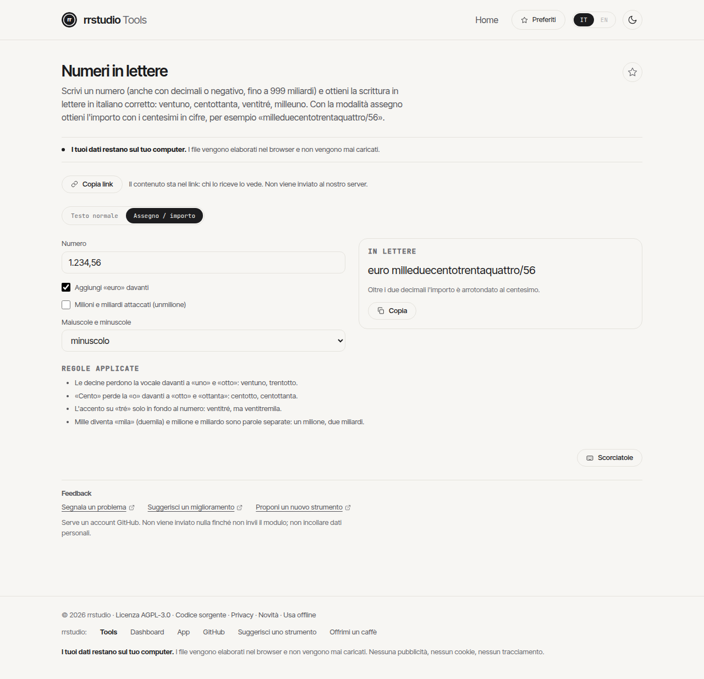

- Route `/numeri-in-lettere`, Italian only (`italyOnly`). Integer part with BigInt up to 999,999,999,999; decimals read as a number after "virgola" (leading zeros one by one); negatives with "meno".
- Spelling rules covered by tests: tens drop the vowel before uno/otto (ventuno, trentotto), cento drops its o before otto/ottanta (centottanta), the accent on tré only at the end (ventitré, ventitremila), mille/mila, "un milione" and "due miliardi" (or attached with an option). Cheque mode rounds to the cent and prints `/50`.

### IBAN & Italian VAT validator


- IBAN: normalisation, mod-97 (ISO 13616), length and BBAN format per country (about 77 countries, SWIFT registry), SEPA flag, grouping by four; Italian IBANs are split into CIN, ABI, CAB and account number and the CIN is verified. The tool never guesses a "corrected" IBAN.
- Partita IVA: 11 digits, check digit, office code (digits 8-10) with the province for the historical codes 001-099; the IT prefix is accepted. A valid format does not mean the number is active (links to VIES and the Agenzia delle Entrate, no calls from the site).
- Bulk check: one value per line, results table and CSV export (formulas are neutralised).

## Favorites and custom menus

Every tool page and every home card has a star button; starred tools appear in a "Your favorites" section at the top of the home page and in a "Favorites" dropdown in the header, together with the custom menus (groups) you create. The management page (`/preferiti`, `/en/favorites`, `noindex` and not in the sitemap) creates, renames, deletes and reorders menus (drag and drop, or up/down buttons from the keyboard), adds tools with a search box, exports and imports JSON (preview, "merge" or "replace") and creates a share link whose data lives in the URL hash (`#d=…`, base64url of a compact JSON): it is never sent to the server, and opening it only shows a preview and asks for confirmation. Everything is stored in `localStorage` under `rrtools.favorites` (`{ v: 1, favorites: [ids], groups: [{ id, name, tools }] }`, at most 20 menus, names up to 40 characters), read only in the browser after hydration, validated on every read (unknown ids dropped) and synced between tabs with the `storage` event. If the storage is missing or full the app still works. The pure logic is in `src/app/core/favorites/` with its own tests.


## Share link

Most text and calculator tools (regex tester, diff, formatters, converters, calculators, generators…) have a "Copy link" button: the tool state (input text and options) is compressed (deflate), encoded in base64url and written in the URL hash (`#s=…`, versioned and per tool); opening the link restores it. The hash is never sent to the server, it is read only in the browser after hydration and validated per tool (types and allowed values, decompressed size capped at 256 KB, links over 8,000 characters are refused with a message). The URL is updated only when the button is pressed. Tools with passwords, keys, personal data or files (password generator and checker, TOTP, file encryption, htpasswd, JWT, hashes, certificates, tax code, IBAN/VAT, e-invoice, EXIF, PDF/image tools…) do not have it. The code is in `src/app/shared/share-state.ts` (codec and validation), `share-link.ts` (button) and one `<tool>.share.ts` schema per tool.

## Privacy

- **Everything runs client-side.** There is no backend: files are read and processed by your browser and are never uploaded.
- **No external requests.** No CDNs, web fonts or third-party scripts: everything is served from the same origin, and the Content Security Policy blocks connections to other servers.
- **No cookies, no tracking, no analytics scripts.** Only your theme, the dismissal of the "available in English" bar, your favorites and custom menus (`rrtools.favorites`: tool ids, menu names and order) and, if you use the Markdown editor, its draft are saved in your browser's `localStorage`; they are never sent anywhere.
- **Technical server logs.** Like any website, the server that delivers the pages logs IP address, date and time, requested path, user agent and referrer; they are used for security and troubleshooting (never for profiling); every day only aggregate totals are derived from them (page views per page, number of visitors counted and immediately forgotten, referring domains, phone or computer), with no IP addresses, user agents or identifiers and are deleted automatically after 30 days at most. The server is hosted by Hetzner in Finland (EU). Files and text you enter in the tools never reach the server.
- **Offline cache.** The site uses a service worker and the browser's Cache Storage only to keep the site files (pages, scripts, styles, fonts) so it works offline; nothing you enter in the tools is saved. You can empty it from the "Use offline" panel in the footer or from the browser settings.
- Full notice (Italian and English): [`/privacy`](https://tools.rr-dev.eu/privacy) and [`/en/privacy`](https://tools.rr-dev.eu/en/privacy).

## Install and offline use

The site is an installable PWA (`public/manifest.webmanifest`, icons generated by `npm run pwa-icons`) with a hand-written service worker, no libraries. `npm run build` runs `ng build` and then `scripts/build-sw.mjs`, which writes `sw.js` in the build root with a version (hash of the contents), a small precached SHELL (both home pages, main scripts, styles, fonts, icons) and the full list of pages and assets (including the pdf.js worker, the Web Workers and the password dictionaries) that the "Use offline" panel in the footer downloads on request. Pages are served network-first (3 s timeout) and fall back to the copy of the same page, then to a translated offline page; hashed files are cache-first and other same-origin files stale-while-revalidate. A new version waits until you press "Update"; requests to other origins are never touched. `npm run pwa-check` verifies it in Chromium (registration, offline navigation after the full download, offline page, update message).

## Getting started

Requirements: Node.js 24 and npm.

```sh
git clone https://github.com/rrstudioapps/rrstudio-tools.git
cd rrstudio-tools
npm ci
npm start                 # dev server on http://localhost:4200
npm test                  # unit tests (Vitest)
npm run build             # static build in dist/rrstudio-tools/browser
```

The build is a set of static, prerendered files (`/index.html`, `/csv-dashboard/index.html`, `/base64/index.html`, JS, CSS, fonts):
upload `dist/rrstudio-tools/browser` to any static host. Configure the host to serve `<path>/index.html`
for `<path>` (most do by default). A ready-made Docker image (nginx, non-root, strict CSP) is in
[`Dockerfile`](Dockerfile) and [`deploy/`](deploy/).

### Adding a tool

Each tool lives in its own folder under `src/app/tools/<id>/` and is a lazy-loaded route. Add it to
`src/app/tools/tools.registry.ts` and it gets its route, its card on the home page and its SEO tags.
See [CONTRIBUTING.md](CONTRIBUTING.md).

### Tech stack

Angular 22 (standalone components, signals, zoneless, prerendering) · TypeScript · Apache ECharts via
ngx-echarts · PapaParse · SheetJS Community Edition · html2canvas · jsPDF · Fontsource (Inter Tight,
JetBrains Mono). Third-party licenses: [THIRD_PARTY_LICENSES.md](THIRD_PARTY_LICENSES.md).

## License

rrstudio Tools is © 2026 rrstudio and is released under the
[GNU Affero General Public License v3.0 or later](LICENSE) (AGPL-3.0-or-later).

- ✅ **Free to use** for any purpose, personal or commercial, and free to study, copy and modify.
- 🔁 **Share alike.** If you distribute a modified version, **or host it as a service that other people use over a network**, you must release your complete source code under the same license (AGPL-3.0, section 13).
- 🏷️ **Keep the attribution.** Keep the copyright headers, the [NOTICE](NOTICE) file and a visible "Based on rrstudio Tools by rrstudio" credit linking to this repository. The rrstudio name and logo are not licensed for promoting modified versions.

This is a summary, not legal advice: the [LICENSE](LICENSE) and [NOTICE](NOTICE) files are what count.

## Support

rrstudio Tools is free and has no ads. If it is useful to you:
[buy me a coffee on Ko-fi](https://ko-fi.com/rrstudioapps), or take a look at the
[premium dashboards](https://demo.rr-dev.eu) (live demos, free download, pay what you want).

---

## In italiano

**rrstudio Tools** è una raccolta di strumenti web gratuiti e open source che funzionano interamente
nel browser. **I tuoi dati restano sul tuo computer:** nessun backend, nessun upload, nessuna chiamata
a server esterni, nessun cookie, nessun tracciamento né script di analytics.

**Link di condivisione.** Molti strumenti di testo e di calcolo hanno il pulsante «Copia link»: lo stato (testo e opzioni) viene compresso, codificato in base64url e scritto nell'hash dell'URL (`#s=…`); aprendo il link si ritrova. L'hash non va mai al server, si legge solo nel browser e viene validato per ogni strumento (tetto di 256 KB decompressi, link oltre 8.000 caratteri rifiutati con un messaggio). Gli strumenti con password, chiavi, dati personali o file non lo hanno.

**Preferiti e menu personalizzati.** Ogni pagina strumento e ogni card della home ha una stella: gli strumenti scelti compaiono in cima alla home e nel menu «Preferiti» dell'intestazione, insieme ai menu personalizzati. La pagina `/preferiti` (`/en/favorites`, `noindex`, fuori dalla sitemap) permette di creare, rinominare, eliminare e riordinare i menu (trascinamento o pulsanti su/giù da tastiera), aggiungere strumenti con la ricerca, esportare e importare JSON (anteprima, «unisci» o «sostituisci») e creare un link di condivisione con i dati nell'hash (`#d=…`): non viene mai inviato al server e all'apertura chiede conferma. Tutto sta in `localStorage` (chiave `rrtools.favorites`, solo id degli strumenti, nomi e ordine dei menu).

- **Prova online:** [tools.rr-dev.eu](https://tools.rr-dev.eu). Strumenti:
  [CSV → Dashboard](https://tools.rr-dev.eu/csv-dashboard), che da un CSV o un Excel genera KPI,
  grafici e tabella, esportabili in HTML autonomo, PNG e PDF. Poi
  [Base64](https://tools.rr-dev.eu/base64), [URL Encode/Decode](https://tools.rr-dev.eu/url-encode) e
  [JSON Formatter](https://tools.rr-dev.eu/json-formatter), [JSON Viewer ed Editor](https://tools.rr-dev.eu/json-viewer) (albero, ricerca, modifica con annulla/ripeti) e
  [Comprimi e converti immagini](https://tools.rr-dev.eu/image-compressor) (JPEG, WebP, PNG, AVIF, con
  confronto prima/dopo e ZIP) e [Strumenti PDF](https://tools.rr-dev.eu/pdf-tools) (unisci, dividi, ruota),
  [Generatore di password](https://tools.rr-dev.eu/password-generator) (password e passphrase, con
  entropia) e [Hash e checksum](https://tools.rr-dev.eu/hash-generator) (MD5, SHA-1, SHA-256, SHA-384,
  SHA-512 di testi e file), [Codice fiscale](https://tools.rr-dev.eu/codice-fiscale) (calcolo, verifica,
  omocodia), [Verifica IBAN e partita IVA](https://tools.rr-dev.eu/iban-partita-iva),
  [Visualizzatore fattura elettronica](https://tools.rr-dev.eu/fattura-elettronica) (XML e P7M),
  [Da immagini a PDF](https://tools.rr-dev.eu/images-to-pdf) e [Da PDF a immagini](https://tools.rr-dev.eu/pdf-to-images),
  [Metadati foto EXIF](https://tools.rr-dev.eu/exif-viewer) (visualizza e rimuovi senza ricomprimere),
  [Generatore di QR code](https://tools.rr-dev.eu/qr-code-generator) (testo, link, WiFi, contatto, email, SMS, posizione; PNG e SVG),
  [Calcolo IVA e ritenuta d'acconto](https://tools.rr-dev.eu/calcolo-iva) (scorporo, notula, rivalsa INPS, cassa, bollo, forfettario),
  [Confronto testi (diff)](https://tools.rr-dev.eu/text-diff),
  [Editor Markdown](https://tools.rr-dev.eu/markdown-editor), [Contatore di parole e caratteri](https://tools.rr-dev.eu/word-counter),
  [Tester di espressioni regolari](https://tools.rr-dev.eu/regex-tester), [Calcolo giorni lavorativi](https://tools.rr-dev.eu/calcolo-giorni-lavorativi),
  [Calcolo ritenuta d'acconto](https://tools.rr-dev.eu/calcolo-ritenuta-acconto) (lordo e netto, prestazione occasionale e parcella),
  [Calcolo rata del mutuo](https://tools.rr-dev.eu/calcolo-rata-mutuo) (piano di ammortamento e CSV),
  [Numeri in lettere](https://tools.rr-dev.eu/numeri-in-lettere) (anche in modalità assegno),
  [Calcolatore di percentuali](https://tools.rr-dev.eu/percentage-calculator), [Convertitore di unità di misura](https://tools.rr-dev.eu/unit-converter),
  [Calcolo date ed età](https://tools.rr-dev.eu/date-calculator), [Convertitore di fusi orari](https://tools.rr-dev.eu/timezone-converter),
  [Convertitore di basi numeriche](https://tools.rr-dev.eu/number-base-converter) (binario, esadecimale, complemento a due, IEEE-754),
  [Calcolatore chmod](https://tools.rr-dev.eu/chmod-calculator), [Convertitore unità CSS](https://tools.rr-dev.eu/css-unit-converter),
  [Generatore CSS](https://tools.rr-dev.eu/css-generator) (gradienti e ombre), [Ottimizzatore SVG](https://tools.rr-dev.eu/svg-optimizer),
  [Generatore di favicon](https://tools.rr-dev.eu/favicon-generator), [Generatore .htpasswd](https://tools.rr-dev.eu/htpasswd-generator),
  [Decodificatore di certificati](https://tools.rr-dev.eu/certificate-decoder) (X.509 e CSR),
  [Verifica robustezza password](https://tools.rr-dev.eu/password-strength-checker), [Generatore TOTP (2FA)](https://tools.rr-dev.eu/totp-generator),
  [Cifra e decifra file](https://tools.rr-dev.eu/file-encrypt) (AES-256-GCM), [Generatore di codici a barre](https://tools.rr-dev.eu/barcode-generator),
  [Lettore di codici QR](https://tools.rr-dev.eu/qr-code-reader), [Ordina righe](https://tools.rr-dev.eu/sort-lines),
  [Trova e sostituisci](https://tools.rr-dev.eu/find-replace), [Sintesi vocale](https://tools.rr-dev.eu/text-to-speech) (solo voci locali) e
  [Generatore di dati finti](https://tools.rr-dev.eu/fake-data-generator) (CF, P.IVA e IBAN formalmente validi, seme, CSV/JSON/SQL),
  [JSONPath, JSON → TypeScript e JSON Schema](https://tools.rr-dev.eu/json-query),
  [Anteprima meta tag e Open Graph](https://tools.rr-dev.eu/meta-tag-preview), [Firma PDF](https://tools.rr-dev.eu/pdf-sign) (firma grafica),
  [Ritaglia e ruota immagini](https://tools.rr-dev.eu/image-crop),
  [Convertitore CSV, JSON ed Excel](https://tools.rr-dev.eu/csv-json-converter), tutti con
  elaborazione solo nel browser.
- **Installazione:** `npm ci`, poi `npm start` per lo sviluppo e `npm run build` per la build
  statica (`dist/rrstudio-tools/browser`, pubblicabile su qualsiasi hosting statico).
- **Uso offline:** il sito è una PWA installabile con un service worker scritto a mano (nessuna
  libreria). Dal pannello «Usa offline» nel footer si scarica tutto per lavorare senza connessione; vengono
  salvati solo i file del sito, mai i dati inseriti negli strumenti. `npm run build` genera anche `sw.js`
  (`scripts/build-sw.mjs`); `npm run pwa-check` lo verifica nel browser.
- **Licenza:** AGPL-3.0-or-later. L'uso è libero, anche commerciale. Chi distribuisce una versione
  modificata **o la ospita come servizio online** deve rilasciarne il codice sorgente con la stessa
  licenza e mantenere l'attribuzione ("Based on rrstudio Tools by rrstudio", file NOTICE e
  intestazioni). Dettagli in [LICENSE](LICENSE) e [NOTICE](NOTICE).
- **Contribuire:** leggi [CONTRIBUTING.md](CONTRIBUTING.md).
