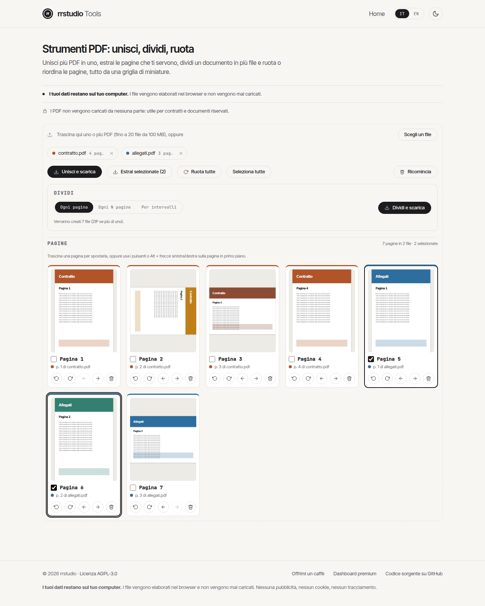
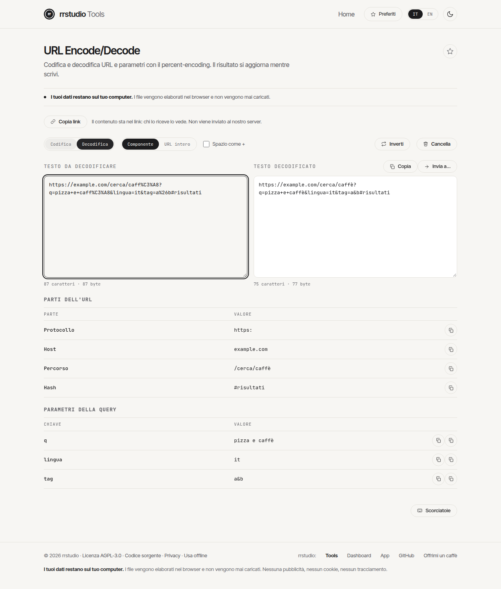

<!-- SPDX-License-Identifier: AGPL-3.0-or-later · © 2026 rrstudio — rrstudio Tools -->

<p align="center">
  
</p>

<h1 align="center">rrstudio Tools</h1>

<p align="center">
  Free, open source web tools that run entirely in your browser.<br>
  <strong>Your data stays on your computer.</strong>
</p>

<p align="center">
  <a href="https://tools.rr-dev.eu"><strong>Live demo → tools.rr-dev.eu</strong></a> ·
  <a href="https://demo.rr-dev.eu">Premium dashboards</a> ·
  <a href="https://ko-fi.com/rrstudioapps">Buy me a coffee</a>
</p>

<p align="center">
  <a href="LICENSE"></a>
  <a href="../../actions/workflows/build.yml"></a>
</p>


## Tools

| Tool | What it does |
|---|---|
| [**CSV → Dashboard**](https://tools.rr-dev.eu/csv-dashboard) | Drop a CSV or Excel file and get KPI cards, a time chart, a category chart and a filterable, sortable table. Customize columns, chart types, color and title, then export as a self-contained HTML file, PNG or PDF. |
| [**Base64 Encode/Decode**](https://tools.rr-dev.eu/base64) | Encode and decode text or files to Base64 with correct UTF-8, an URL-safe option and data URLs. Drop a file to get its Base64, or decode back to a downloadable file with an image preview. |
| [**URL Encode/Decode**](https://tools.rr-dev.eu/url-encode) | Percent-encode and decode text, as a component or as a full URL, with optional "space as +". Shows a copyable table of the URL parts and decoded query parameters. |
| [**JSON Formatter and Validator**](https://tools.rr-dev.eu/json-formatter) | Format (2 / 4 spaces or tab), minify and sort keys, with live validation: errors show line and column, plus size, key count and depth, and light syntax highlighting. |
| [**Image compressor & converter**](https://tools.rr-dev.eu/image-compressor) | Compress and convert many images at once to JPEG, WebP, PNG or AVIF, with quality and resize options, a before/after slider and a ZIP download. Done in your browser; EXIF metadata (GPS included) is stripped. |
| [**PDF tools: merge, split, rotate**](https://tools.rr-dev.eu/pdf-tools) | Merge several PDFs, extract or split pages (every page, every N pages or by ranges like `1-3, 5, 8-10`), rotate, delete and reorder pages from a grid of thumbnails. Your PDFs are never uploaded: fine for confidential documents. |

More tools are coming, with the same rule: nothing leaves your browser.

### CSV → Dashboard


<details>
<summary>Dark theme and mobile</summary>


</details>

- CSV (any delimiter, UTF-8 or Windows-1252) and XLSX/XLS files, via drag & drop or file picker.
- Automatic column type detection: date, number (Italian and English formats, currency, %), category, text.
- KPI cards: total, average, row count, change versus the previous period when there is a date column.
- Line/area/bar chart over time and bar/pie chart by category (Apache ECharts).
- Exports: a single offline HTML file, PNG and multi-page PDF.
- "Try with sample data" with a demo sales CSV.
- Italian and English UI, light and dark theme, responsive.

### Base64 Encode/Decode


- Live encode/decode with correct UTF-8 (accents, emoji), URL-safe option, whitespace and padding tolerant decoding.
- Files up to 25 MB by drag & drop, optionally as a data URL, with an image preview.
- Decoding a data URL or binary Base64 offers "Download file" (MIME from the data URL or magic bytes: png, jpg, gif, webp, pdf, zip).

### Image compressor & converter


- Up to 50 images (JPG, PNG, WebP, AVIF, GIF first frame, BMP), 50 MB each, by drag & drop or file picker.
- Output: original format, JPEG, WebP, PNG or AVIF (only the formats your browser can actually encode are offered); quality 1-100; resize by max width, max height or percentage (never enlarges); background colour for transparency in JPEG.
- Decoding, resizing and encoding run in a Web Worker (`createImageBitmap` + `OffscreenCanvas`), with a main-thread fallback. EXIF orientation is respected and all metadata, GPS included, is removed.
- Per-file before/after size and pixels, saving in %, a draggable (and keyboard-operable) before/after slider, single download and a ZIP of everything (fflate, MIT, loaded on demand). If a result is larger than the original in the same format, the original is kept.

### PDF tools: merge, split, rotate



- Up to 20 PDFs (100 MB each) by drag & drop or file picker; password-protected files are skipped with a clear message. Every page of every file appears in one grid of thumbnails, with its number and a discreet colour and label for the source file.
- Per page: rotate left/right, delete, select. Reorder by drag & drop (native HTML5) or with the move buttons / Alt + arrow keys, with screen-reader announcements.
- Actions: merge everything in the current order and rotation, extract the selected pages, rotate all, or split (every page, every N pages, or by ranges such as `1-3, 5, 8-10`, validated with clear errors). Several output files come as a ZIP (fflate).
- Output PDFs are built with pdf-lib (MIT); Producer/Creator are "rrstudio Tools" and the title of the first file is kept. Thumbnails are drawn lazily, one at a time, with pdf.js (Apache-2.0); its worker and standard fonts are served from the same origin (no CDN, no `unsafe-eval`).

### URL Encode/Decode



- `encodeURIComponent` (component) or `encodeURI` (full URL), with "space as +" for form-urlencoded data.
- Clear errors on invalid `%` sequences; a table with protocol, host, path, hash and each decoded query parameter.

### JSON Formatter and Validator


- Format, minify, sort keys recursively; copy, download as `.json` or load a `.json` file by drag & drop.
- Line numbers with the error line marked; line and column are worked out for V8/Chromium, Firefox and Safari messages.
- Hand-made syntax highlighting (no editor library, no `innerHTML`).

## Privacy

- **Everything runs client-side.** There is no backend: files are read and processed by your browser and are never uploaded.
- **No external requests.** No CDNs, web fonts or third-party scripts: everything is served from the same origin, and the Content Security Policy blocks connections to other servers.
- **No cookies, no tracking, no analytics.** Only your language and theme preferences are saved, in your browser's `localStorage`.

## Getting started

Requirements: Node.js 24 and npm.

```sh
git clone https://github.com/rrstudioapps/rrstudio-tools.git
cd rrstudio-tools
npm ci
npm start                 # dev server on http://localhost:4200
npm test                  # unit tests (Vitest)
npm run build             # static build in dist/rrstudio-tools/browser
```

The build is a set of static, prerendered files (`/index.html`, `/csv-dashboard/index.html`, `/base64/index.html`, JS, CSS, fonts):
upload `dist/rrstudio-tools/browser` to any static host. Configure the host to serve `<path>/index.html`
for `<path>` (most do by default). A ready-made Docker image (nginx, non-root, strict CSP) is in
[`Dockerfile`](Dockerfile) and [`deploy/`](deploy/).

### Adding a tool

Each tool lives in its own folder under `src/app/tools/<id>/` and is a lazy-loaded route. Add it to
`src/app/tools/tools.registry.ts` and it gets its route, its card on the home page and its SEO tags.
See [CONTRIBUTING.md](CONTRIBUTING.md).

### Tech stack

Angular 22 (standalone components, signals, zoneless, prerendering) · TypeScript · Apache ECharts via
ngx-echarts · PapaParse · SheetJS Community Edition · html2canvas · jsPDF · Fontsource (Inter Tight,
JetBrains Mono). Third-party licenses: [THIRD_PARTY_LICENSES.md](THIRD_PARTY_LICENSES.md).

## License

rrstudio Tools is © 2026 rrstudio and is released under the
[GNU Affero General Public License v3.0 or later](LICENSE) (AGPL-3.0-or-later).

- ✅ **Free to use** for any purpose, personal or commercial, and free to study, copy and modify.
- 🔁 **Share alike.** If you distribute a modified version, **or host it as a service that other people use over a network**, you must release your complete source code under the same license (AGPL-3.0, section 13).
- 🏷️ **Keep the attribution.** Keep the copyright headers, the [NOTICE](NOTICE) file and a visible "Based on rrstudio Tools by rrstudio" credit linking to this repository. The rrstudio name and logo are not licensed for promoting modified versions.

This is a summary, not legal advice: the [LICENSE](LICENSE) and [NOTICE](NOTICE) files are what count.

## Support

rrstudio Tools is free and has no ads. If it is useful to you:
[buy me a coffee on Ko-fi](https://ko-fi.com/rrstudioapps), or take a look at the
[premium dashboards](https://demo.rr-dev.eu) (live demos, free download, pay what you want).

---

## In italiano

**rrstudio Tools** è una raccolta di strumenti web gratuiti e open source che funzionano interamente
nel browser. **I tuoi dati restano sul tuo computer:** nessun backend, nessun upload, nessuna chiamata
a server esterni, nessun cookie, nessun tracciamento o analytics.

- **Prova online:** [tools.rr-dev.eu](https://tools.rr-dev.eu). Strumenti:
  [CSV → Dashboard](https://tools.rr-dev.eu/csv-dashboard), che da un CSV o un Excel genera KPI,
  grafici e tabella, esportabili in HTML autonomo, PNG e PDF. Poi
  [Base64](https://tools.rr-dev.eu/base64), [URL Encode/Decode](https://tools.rr-dev.eu/url-encode) e
  [JSON Formatter](https://tools.rr-dev.eu/json-formatter) e
  [Comprimi e converti immagini](https://tools.rr-dev.eu/image-compressor) (JPEG, WebP, PNG, AVIF, con
  confronto prima/dopo e ZIP) e [Strumenti PDF](https://tools.rr-dev.eu/pdf-tools) (unisci, dividi, ruota),
  tutti con elaborazione solo nel browser.
- **Installazione:** `npm ci`, poi `npm start` per lo sviluppo e `npm run build` per la build
  statica (`dist/rrstudio-tools/browser`, pubblicabile su qualsiasi hosting statico).
- **Licenza:** AGPL-3.0-or-later. L'uso è libero, anche commerciale. Chi distribuisce una versione
  modificata **o la ospita come servizio online** deve rilasciarne il codice sorgente con la stessa
  licenza e mantenere l'attribuzione ("Based on rrstudio Tools by rrstudio", file NOTICE e
  intestazioni). Dettagli in [LICENSE](LICENSE) e [NOTICE](NOTICE).
- **Contribuire:** leggi [CONTRIBUTING.md](CONTRIBUTING.md).
