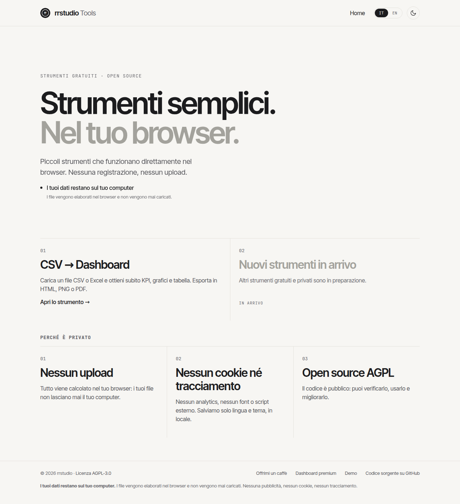

<!-- SPDX-License-Identifier: AGPL-3.0-or-later · © 2026 rrstudio — rrstudio Tools -->

<p align="center">
  
</p>

<h1 align="center">rrstudio Tools</h1>

<p align="center">
  Free, open source web tools that run entirely in your browser.<br>
  <strong>Your data stays on your computer.</strong>
</p>

<p align="center">
  <a href="https://tools.rr-dev.eu"><strong>Live demo → tools.rr-dev.eu</strong></a> ·
  <a href="https://demo.rr-dev.eu">Premium dashboards</a> ·
  <a href="https://ko-fi.com/rrstudioapps">Buy me a coffee</a>
</p>

<p align="center">
  <a href="LICENSE"></a>
  <a href="../../actions/workflows/build.yml"></a>
</p>



## Tools

| Tool | What it does |
|---|---|
| [**CSV → Dashboard**](https://tools.rr-dev.eu/csv-dashboard) | Drop a CSV or Excel file and get KPI cards, a time chart, a category chart and a filterable, sortable table. Customize columns, chart types, color and title, then export as a self-contained HTML file, PNG or PDF. |

More tools are coming, with the same rule: nothing leaves your browser.

### CSV → Dashboard


<details>
<summary>Dark theme and mobile</summary>


</details>

- CSV (any delimiter, UTF-8 or Windows-1252) and XLSX/XLS files, via drag & drop or file picker.
- Automatic column type detection: date, number (Italian and English formats, currency, %), category, text.
- KPI cards: total, average, row count, change versus the previous period when there is a date column.
- Line/area/bar chart over time and bar/pie chart by category (Apache ECharts).
- Exports: a single offline HTML file, PNG and multi-page PDF.
- "Try with sample data" with a demo sales CSV.
- Italian and English UI, light and dark theme, responsive.

## Privacy

- **Everything runs client-side.** There is no backend: files are read and processed by your browser and are never uploaded.
- **No external requests.** No CDNs, web fonts or third-party scripts: everything is served from the same origin, and the Content Security Policy blocks connections to other servers.
- **No cookies, no tracking, no analytics.** Only your language and theme preferences are saved, in your browser's `localStorage`.

## Getting started

Requirements: Node.js 24 and npm.

```sh
git clone https://github.com/rrstudioapps/rrstudio-tools.git
cd rrstudio-tools
npm ci
npm start                 # dev server on http://localhost:4200
npm test                  # unit tests (Vitest)
npm run build             # static build in dist/rrstudio-tools/browser
```

The build is a set of static, prerendered files (`/index.html`, `/csv-dashboard/index.html`, JS, CSS, fonts):
upload `dist/rrstudio-tools/browser` to any static host. Configure the host to serve `<path>/index.html`
for `<path>` (most do by default). A ready-made Docker image (nginx, non-root, strict CSP) is in
[`Dockerfile`](Dockerfile) and [`deploy/`](deploy/).

### Adding a tool

Each tool lives in its own folder under `src/app/tools/<id>/` and is a lazy-loaded route. Add it to
`src/app/tools/tools.registry.ts` and it gets its route, its card on the home page and its SEO tags.
See [CONTRIBUTING.md](CONTRIBUTING.md).

### Tech stack

Angular 22 (standalone components, signals, zoneless, prerendering) · TypeScript · Apache ECharts via
ngx-echarts · PapaParse · SheetJS Community Edition · html2canvas · jsPDF · Fontsource (Inter Tight,
JetBrains Mono). Third-party licenses: [THIRD_PARTY_LICENSES.md](THIRD_PARTY_LICENSES.md).

## License

rrstudio Tools is © 2026 rrstudio and is released under the
[GNU Affero General Public License v3.0 or later](LICENSE) (AGPL-3.0-or-later).

- ✅ **Free to use** for any purpose, personal or commercial, and free to study, copy and modify.
- 🔁 **Share alike.** If you distribute a modified version, **or host it as a service that other people use over a network**, you must release your complete source code under the same license (AGPL-3.0, section 13).
- 🏷️ **Keep the attribution.** Keep the copyright headers, the [NOTICE](NOTICE) file and a visible "Based on rrstudio Tools by rrstudio" credit linking to this repository. The rrstudio name and logo are not licensed for promoting modified versions.

This is a summary, not legal advice: the [LICENSE](LICENSE) and [NOTICE](NOTICE) files are what count.

## Support

rrstudio Tools is free and has no ads. If it is useful to you:
[buy me a coffee on Ko-fi](https://ko-fi.com/rrstudioapps), or take a look at the
[premium dashboards](https://demo.rr-dev.eu) (live demos, free download, pay what you want).

---

## In italiano

**rrstudio Tools** è una raccolta di strumenti web gratuiti e open source che funzionano interamente
nel browser. **I tuoi dati restano sul tuo computer:** nessun backend, nessun upload, nessuna chiamata
a server esterni, nessun cookie, nessun tracciamento o analytics.

- **Prova online:** [tools.rr-dev.eu](https://tools.rr-dev.eu). Primo strumento:
  [CSV → Dashboard](https://tools.rr-dev.eu/csv-dashboard), che da un CSV o un Excel genera KPI,
  grafici e tabella, esportabili in HTML autonomo, PNG e PDF.
- **Installazione:** `npm ci`, poi `npm start` per lo sviluppo e `npm run build` per la build
  statica (`dist/rrstudio-tools/browser`, pubblicabile su qualsiasi hosting statico).
- **Licenza:** AGPL-3.0-or-later. L'uso è libero, anche commerciale. Chi distribuisce una versione
  modificata **o la ospita come servizio online** deve rilasciarne il codice sorgente con la stessa
  licenza e mantenere l'attribuzione ("Based on rrstudio Tools by rrstudio", file NOTICE e
  intestazioni). Dettagli in [LICENSE](LICENSE) e [NOTICE](NOTICE).
- **Contribuire:** leggi [CONTRIBUTING.md](CONTRIBUTING.md).
