<!-- SPDX-License-Identifier: AGPL-3.0-or-later · © 2026 rrstudio — rrstudio Tools -->

<p align="center">
  
</p>

<h1 align="center">rrstudio Tools</h1>

<p align="center">
  Free, open source web tools that run entirely in your browser.<br>
  <strong>Your data stays on your computer.</strong>
</p>

<p align="center">
  <a href="https://tools.rr-dev.eu"><strong>Live demo → tools.rr-dev.eu</strong></a> ·
  <a href="https://demo.rr-dev.eu">Premium dashboards</a> ·
  <a href="https://ko-fi.com/rrstudioapps">Buy me a coffee</a>
</p>

<p align="center">
  <a href="LICENSE"></a>
  <a href="../../actions/workflows/build.yml"></a>
</p>


## Languages and URLs

The language of a page is decided by its URL, not by the browser or a saved preference. The root is Italian (`/`, `/pdf-tools`); the English versions live under `/en/` with the same slugs (`/en/`, `/en/pdf-tools`). Every page is prerendered in its own language, with `<html lang>`, title, description, Open Graph tags, `canonical` and `hreflang` links (`it`, `en`, and `x-default` pointing to English). `public/sitemap.xml` lists all of them with `xhtml:link` alternates. Each tool has its own 1200×630 social image per language (`public/og/<lang>/<slug>.png`, generated by `npm run og-images`), used for `og:image` and `twitter:image`; the home pages use `public/og-image.png`.

Tools that only make sense in Italy (codice fiscale, IBAN & partita IVA, e-invoice, VAT & withholding calculator) are flagged `italyOnly` in the registry: they have no `/en/` page, the EN switch is disabled on them, and the English home links to them in a discreet line. An unknown `/en/...` address goes to `/en/`. Visitors whose browser is not in Italian get a small, dismissible hint on Italian pages that have an English version; there is no automatic redirect.

## Tools

The home page groups the tools by category, with filter pills (shareable as `?categoria=sviluppatori`, or `?category=developers` on the English home) and a search box.

### Data & documents

Tables, JSON, PDF and images.

| Tool | What it does |
|---|---|
| [**CSV → Dashboard**](https://tools.rr-dev.eu/csv-dashboard) | Drop a CSV or Excel file and get KPI cards, a time chart, a category chart and a filterable, sortable table. Customize columns, chart types, color and title, then export as a self-contained HTML file, PNG or PDF. |
| [**JSON Viewer & Editor**](https://tools.rr-dev.eu/json-viewer) | Explore JSON as a lazy, paginated tree (files up to 50 MB), search keys and values, copy the JavaScript path or JSON Pointer of a node, edit values and keys inline, add, delete, duplicate, move and retype nodes, with undo/redo and a formatted Text view. |
| [**JSON Formatter and Validator**](https://tools.rr-dev.eu/json-formatter) | Format (2 / 4 spaces or tab), minify and sort keys, with live validation: errors show line and column, plus size, key count and depth, and light syntax highlighting. |
| [**PDF tools: merge, split, rotate**](https://tools.rr-dev.eu/pdf-tools) | Merge several PDFs, extract or split pages (every page, every N pages or by ranges like `1-3, 5, 8-10`), rotate, delete and reorder pages from a grid of thumbnails. Your PDFs are never uploaded: fine for confidential documents. |
| [**Image compressor & converter**](https://tools.rr-dev.eu/image-compressor) | Compress and convert many images at once to JPEG, WebP, PNG or AVIF, with quality and resize options, a before/after slider and a ZIP download. Done in your browser; EXIF metadata (GPS included) is stripped. |
| [**Images to PDF**](https://tools.rr-dev.eu/images-to-pdf) | Combine JPG, PNG and WebP images into one PDF: reorder the thumbnails (drag & drop or keyboard), choose A4, Letter or fit-to-image pages, orientation, margins, 1, 2 or 4 images per page and the quality. EXIF orientation is respected. |
| [**PDF to images**](https://tools.rr-dev.eu/pdf-to-images) | Turn PDF pages (all, or a range like `1-3, 5`) into PNG or JPEG at 72, 150 or 300 dpi, with previews and single or ZIP download. |
| [**QR code generator**](https://tools.rr-dev.eu/qr-code-generator) | QR codes for text, links, WiFi, contacts (vCard), email, SMS and locations, with error correction, size, margin, colours (with a low-contrast warning) and an optional centre logo. Download PNG or SVG, or copy the image. |
| [**CSV, JSON & Excel converter**](https://tools.rr-dev.eu/csv-json-converter) | Convert CSV, JSON and Excel into each other: automatic delimiter, header row, array of objects or of arrays, nested objects flattened to `a.b` and rebuilt, sheet picker, table preview. Formulas in the exported CSV and XLSX are neutralised. |
| [**Markdown editor**](https://tools.rr-dev.eu/markdown-editor) | Write Markdown (CommonMark + GFM: headings, lists and task lists, tables with alignment, quotes, code blocks with language) with a live side-by-side preview, a formatting toolbar and shortcuts. Safe preview: raw HTML is never run and external images are not loaded. Export `.md`, a standalone HTML file or PDF (browser print). The draft stays in your browser. |
| [**Word & character counter**](https://tools.rr-dev.eu/word-counter) | Words, characters (with and without spaces, emoji and accents count 1), sentences, paragraphs, lines, reading (about 200 wpm) and speaking (about 130 wpm) time, most frequent words without Italian/English stopwords, length limits (SMS, X, meta description, title, Instagram) and case conversions. |

### Developers

Encode, decode and compute.

| Tool | What it does |
|---|---|
| [**Base64 Encode/Decode**](https://tools.rr-dev.eu/base64) | Encode and decode text or files to Base64 with correct UTF-8, an URL-safe option and data URLs. Drop a file to get its Base64, or decode back to a downloadable file with an image preview. |
| [**URL Encode/Decode**](https://tools.rr-dev.eu/url-encode) | Percent-encode and decode text, as a component or as a full URL, with optional "space as +". Shows a copyable table of the URL parts and decoded query parameters. |
| [**Text compare (diff)**](https://tools.rr-dev.eu/text-diff) | Compare two texts or files line by line (Myers algorithm), with word or character differences inside changed lines, side-by-side or inline view, options to ignore whitespace, case and blank lines, navigation between differences and export as a unified diff (`.patch`). Runs in a Web Worker, fine with 5,000 lines. |
| [**Hash & checksum**](https://tools.rr-dev.eu/hash-generator) | MD5, SHA-1, SHA-256, SHA-384 and SHA-512 of a text (live) or a file up to 2 GB, in hex and Base64, with a progress bar, cancel and a "compare with a checksum" field. |
| [**JWT decoder**](https://tools.rr-dev.eu/jwt-decoder) | Paste a JSON Web Token (a leading `Bearer ` is fine) and read the header and payload, highlighted, the algorithm and the `exp`, `iat`, `nbf` and `auth_time` dates in your time zone and in UTC with "expires in…/expired … ago". Clear errors for missing segments, bad Base64URL or JSON; JWE (5 segments) is recognised. The signature is **not** verified. |
| [**UUID generator**](https://tools.rr-dev.eu/uuid-generator) | UUID v4, UUID v7 (correct timestamp, monotonic within a millisecond) and ULID, 1-1000 at a time, upper/lower case, with or without hyphens, with braces; copy all or download a `.txt`. A validator reads the version, variant and the date inside v7 and ULID. Only `crypto.getRandomValues`. |
| [**Unix timestamp converter**](https://tools.rr-dev.eu/timestamp-converter) | Timestamp to date (seconds, milliseconds, microseconds or nanoseconds, detected) and date to timestamp, ISO 8601, RFC 2822 and a readable format, any time zone of your browser with daylight saving handled, a live "now", relative time, and many timestamps at once (one per line). |
| [**Color contrast checker (WCAG)**](https://tools.rr-dev.eu/color-contrast-checker) | Two colors (picker or HEX, rgb(), hsl(), oklch(), CSS names, with alpha), WCAG 2.x contrast ratio with AA/AAA for normal text, large text and graphical objects, preview, swap, copyable HEX/RGB/HSL/OKLCH and the closest color (lightness in OKLCH) that reaches AA and AAA. |
| [**Regex tester**](https://tools.rr-dev.eu/regex-tester) | Test JavaScript regular expressions: flags `g i m s u y d`, highlighted matches, numbered and named groups, replacement preview (`$1`, `$<name>`, `$&`), the pattern explained in plain words and an example library. Runs in a Web Worker with a 1 second timeout, so catastrophic backtracking cannot freeze the page. |

### Security

Strong passwords and photo metadata.

| Tool | What it does |
|---|---|
| [**Password generator**](https://tools.rr-dev.eu/password-generator) | Random passwords (4-128 characters, choose the character sets, exclude ambiguous ones) and passphrases (3-12 words from the EFF large wordlist), with honest entropy in bits, a strength bar and the estimated time to guess. Nothing is stored. |
| [**EXIF viewer & remover**](https://tools.rr-dev.eu/exif-viewer) | See the EXIF, GPS, XMP and IPTC metadata of JPEG, PNG and WebP photos, with warnings for GPS, serial numbers and owner names, and remove it with no recompression (pixels stay identical). Before/after field counts, single or ZIP download. |

### Italy: tax & banking

Codice fiscale, IBAN, VAT number and electronic invoices.

| Tool | What it does |
|---|---|
| [**Italian tax code (codice fiscale)**](https://tools.rr-dev.eu/codice-fiscale) | Calculate the codice fiscale (official DM 23/12/1976 rules, Italian municipality with type-ahead search, foreign country or manual code) and check and decode a code: structure, check character, sex, birth date (century ambiguity) and place, omocodia included. |
| [**IBAN & Italian VAT validator**](https://tools.rr-dev.eu/iban-partita-iva) | One field that recognises an IBAN or a partita IVA, plus separate tabs and a bulk check (one value per line, CSV export). IBAN: mod-97, length and format per country, Italian CIN/ABI/CAB. VAT: check digit and office code. |
| [**VAT, VAT extraction & withholding tax (in Italian)**](https://tools.rr-dev.eu/calcolo-iva) | Add or extract Italian VAT (22/10/5/4/0%), prepare a freelancer invoice with INPS surcharge, pension fund, 20% withholding tax, 2 € stamp duty and the flat-rate regime (with the legal notes to print on the invoice), and work backwards from the net you want to receive. Integer-cent arithmetic; indicative, not tax advice; 2026 rules. |
| [**Italian e-invoice viewer (FatturaPA XML/P7M)**](https://tools.rr-dev.eu/fattura-elettronica) | Open an electronic invoice as XML, signed .p7m (DER or Base64) or a ZIP of invoices and read it laid out: parties, lines, VAT summary, totals, payment, attachments. Print or save as PDF. The signature is not verified. |
| [**Working days calculator (in Italian)**](https://tools.rr-dev.eu/calcolo-giorni-lavorativi) | Working days between two dates (calendar days, weekends, holidays on weekdays listed) or a deadline by adding/subtracting working days. Italian national holidays with Easter (Gauss/Meeus algorithm), optional patron saint of a regional capital and one custom date. Indicative. |

More tools are coming, with the same rule: nothing leaves your browser.

### CSV → Dashboard


<details>
<summary>Dark theme and mobile</summary>


</details>

- CSV (any delimiter, UTF-8 or Windows-1252) and XLSX/XLS files, via drag & drop or file picker.
- Automatic column type detection: date, number (Italian and English formats, currency, %), category, text.
- KPI cards: total, average, row count, change versus the previous period when there is a date column.
- Line/area/bar chart over time and bar/pie chart by category (Apache ECharts).
- Exports: a single offline HTML file, PNG and multi-page PDF.
- "Try with sample data" with a demo sales CSV.
- Italian and English UI, light and dark theme, responsive.

### Base64 Encode/Decode


- Live encode/decode with correct UTF-8 (accents, emoji), URL-safe option, whitespace and padding tolerant decoding.
- Files up to 25 MB by drag & drop, optionally as a data URL, with an image preview.
- Decoding a data URL or binary Base64 offers "Download file" (MIME from the data URL or magic bytes: png, jpg, gif, webp, pdf, zip).

### QR code generator


- Route `/qr-code-generator` (also `/en/qr-code-generator`). Types: text, URL (`https://` added when missing), WiFi (`WIFI:T:…;S:…;P:…;H:…;;` with `\ ; , : "` escaped), contact (vCard 3.0), email (`mailto:` with subject and body), SMS (`sms:` with body) and location (`geo:`).
- The encoder is written in plain TypeScript (ISO/IEC 18004, no library): numeric, alphanumeric and byte (UTF-8) modes, versions 1-40, error correction L/M/Q/H with Reed-Solomon, the four mask penalties. Tests check known codewords from the standard, the capacity tables and a round trip through a test-only decoder with Reed-Solomon correction for all 160 version/level combinations.
- Options: size in pixels, margin (quiet zone), colours with a warning when the contrast is too low or the code is inverted, and an optional centre logo (your image, reduced in the browser; it forces level H and covers at most 20% of the side). Export PNG at the chosen size, vector SVG, or copy the image where the browser allows it.
- QR codes are static: they never go through a server and never expire.

### Image compressor & converter


- Up to 50 images (JPG, PNG, WebP, AVIF, GIF first frame, BMP), 50 MB each, by drag & drop or file picker.
- Output: original format, JPEG, WebP, PNG or AVIF (only the formats your browser can actually encode are offered); quality 1-100; resize by max width, max height or percentage (never enlarges); background colour for transparency in JPEG.
- Decoding, resizing and encoding run in a Web Worker (`createImageBitmap` + `OffscreenCanvas`), with a main-thread fallback. EXIF orientation is respected and all metadata, GPS included, is removed.
- Per-file before/after size and pixels, saving in %, a draggable (and keyboard-operable) before/after slider, single download and a ZIP of everything (fflate, MIT, loaded on demand). If a result is larger than the original in the same format, the original is kept.

### PDF tools: merge, split, rotate


- Up to 20 PDFs (100 MB each) by drag & drop or file picker; password-protected files are skipped with a clear message. Every page of every file appears in one grid of thumbnails, with its number and a discreet colour and label for the source file.
- Per page: rotate left/right, delete, select. Reorder by drag & drop (native HTML5) or with the move buttons / Alt + arrow keys, with screen-reader announcements.
- Actions: merge everything in the current order and rotation, extract the selected pages, rotate all, or split (every page, every N pages, or by ranges such as `1-3, 5, 8-10`, validated with clear errors). Several output files come as a ZIP (fflate).
- Output PDFs are built with pdf-lib (MIT); Producer/Creator are "rrstudio Tools" and the title of the first file is kept. Thumbnails are drawn lazily, one at a time, with pdf.js (Apache-2.0); its worker and standard fonts are served from the same origin (no CDN, no `unsafe-eval`).

### Images to PDF

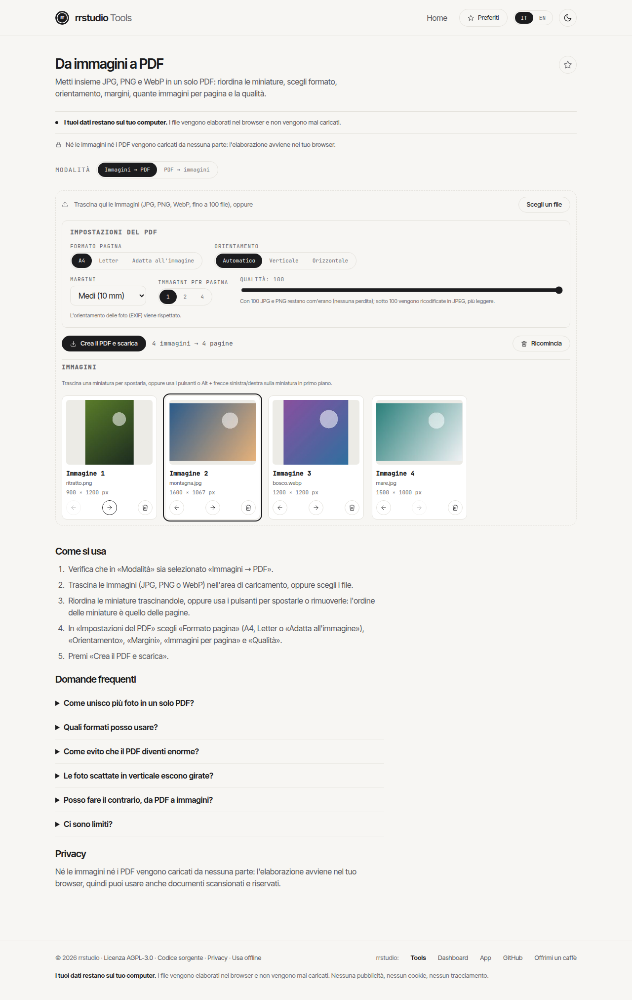

- Route `/images-to-pdf`. Up to 100 images (JPG, PNG, WebP, 50 MB each) as thumbnails that can be reordered by drag & drop, with buttons or with Alt + arrow keys (screen-reader announcements). HEIC is not supported by browsers: a clear message explains how to export a JPG.
- Page: A4, Letter or "fit to image" (the page has the image's proportions at 150 dpi), orientation automatic/portrait/landscape, margins none/5/10/20 mm, 1, 2 or 4 images per page.
- Quality 100 keeps JPG and PNG files byte for byte (lossless); lower values re-encode them as JPEG. EXIF orientation is respected. The PDF is built with pdf-lib (MIT); pages are laid out by a pure, unit-tested function.
- The mode switch moves to `/pdf-to-images` (same page component, mode preset by the route).

### PDF to images


- Route `/pdf-to-images`. One PDF (100 MB; password-protected files are refused with a clear message), pages all or by range (same parser as the PDF tools, with clear errors), PNG or JPEG, 72, 150 or 300 dpi, up to 50 pages per run.
- Pages are drawn with pdf.js (Apache-2.0), whose worker comes from the same origin; very large pages are scaled down to 50 megapixels. Previews, single download or a ZIP (fflate).

### EXIF viewer & remover

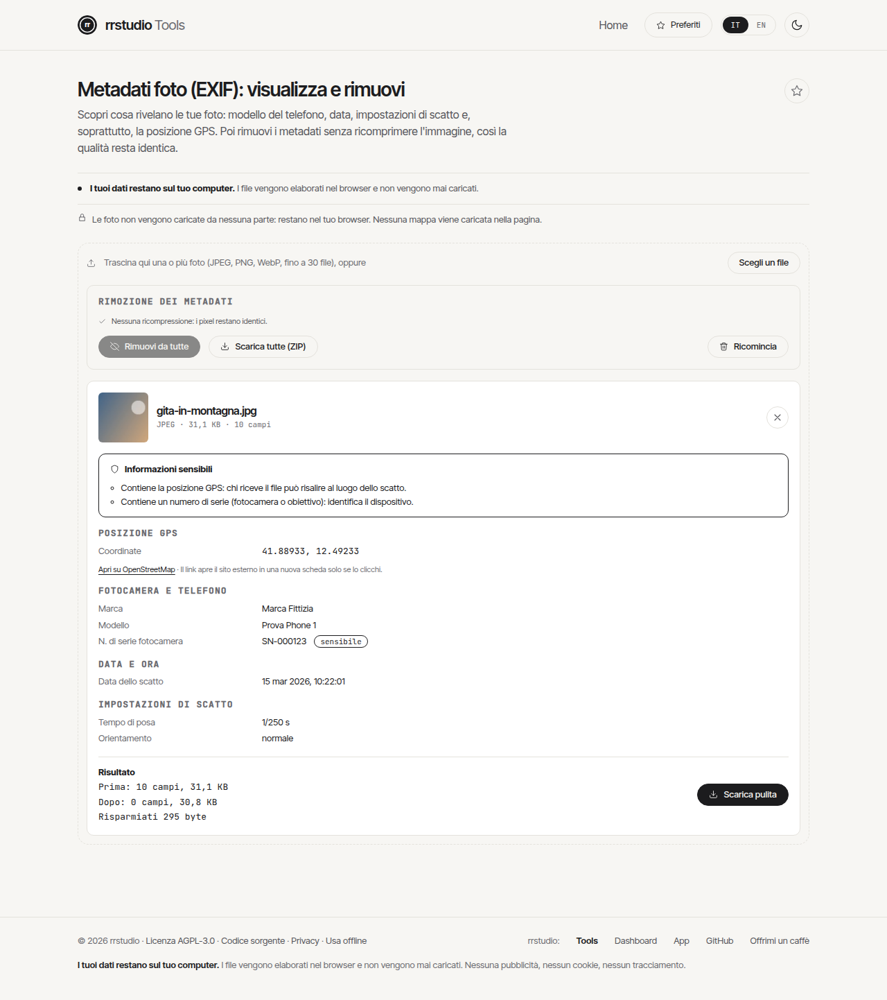

- JPEG, PNG and WebP (HEIC is reported as unsupported). A purpose-written, bounds-checked parser reads EXIF/TIFF (JPEG APP1, PNG `eXIf`, WebP `EXIF`), XMP and IPTC, PNG text chunks and the embedded thumbnail, grouped as camera, date and time, shooting settings, software, author and copyright.
- Warnings for GPS, serial numbers and owner or author names. GPS shows coordinates, altitude and accuracy plus a plain text link "Open on OpenStreetMap": no map or external request is made unless you click it.
- Removal does not recompress: JPEG drops the APP1 (EXIF/XMP), APP13 (IPTC) and comment segments; PNG drops `eXIf`, `tEXt`, `zTXt`, `iTXt` and `tIME`; WebP drops the `EXIF` and `XMP ` chunks and updates the VP8X header and the RIFF size. For photos with an EXIF orientation other than 1 you choose between keeping a minimal EXIF with only the orientation, or rotating the pixels (which recompresses). Tests check that the cleaned file has no metadata left and that the image data is byte for byte identical.
- Before/after field counts and bytes saved; single download or ZIP.

### CSV, JSON & Excel converter

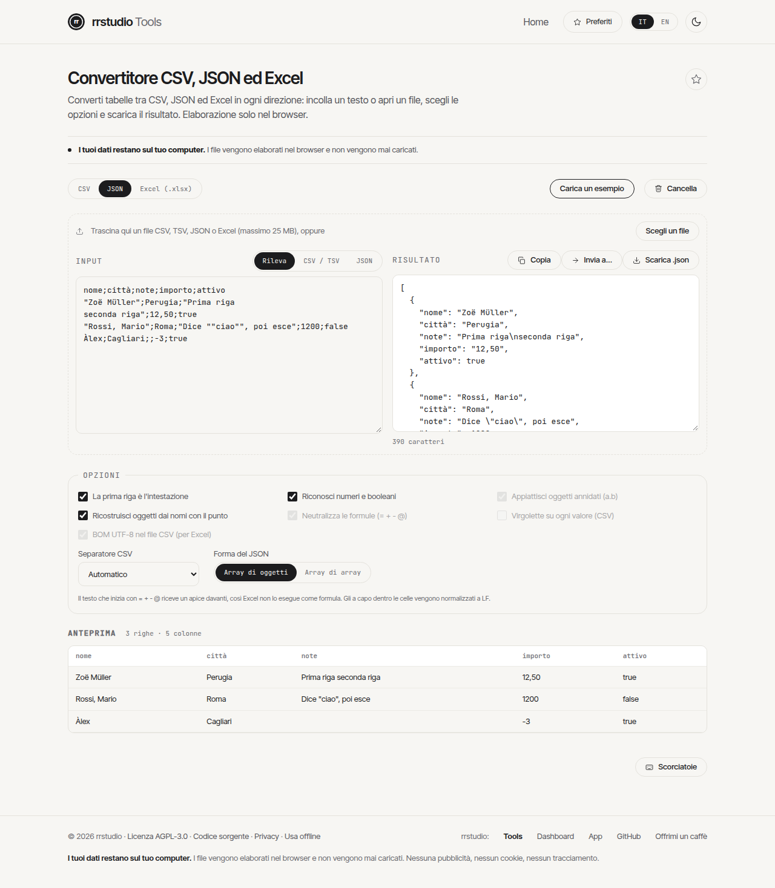

- Route `/csv-json-converter`. Input from pasted text or a file (CSV, TSV, JSON, XLSX, XLS); output as CSV, JSON or a downloadable `.xlsx`. PapaParse and SheetJS are loaded only when needed.
- CSV options: delimiter (automatic, comma, semicolon, tab), header row on or off, quote every value, UTF-8 BOM for Excel. Numbers and booleans are recognised only when the conversion is exact, so `007` or `1.50` stay text.
- JSON as array of objects or array of arrays; nested objects flattened with dot notation (`address.city`, `tags.0`) and rebuilt on the way back; workbooks with several sheets get a sheet picker; a table preview shows the first rows.
- Text that starts with `=`, `+`, `-` or `@` gets a leading apostrophe in CSV and XLSX exports (switchable), so spreadsheets do not run it as a formula; real numbers are untouched. Line breaks inside cells are normalised to LF.

### Password generator


- Passwords of 4-128 characters from lowercase, uppercase, digits and symbols (at least one set always on), optional "exclude ambiguous characters" (`0 O o 1 l I |`) and a guarantee of at least one character per chosen set. Passphrases of 3-12 words with a separator, capitalisation and an optional number.
- Randomness only from `crypto.getRandomValues`, with rejection sampling (no modulo bias); unit tests check the absence of bias and the set guarantee.
- Entropy is the log2 of the real number of possible results (inclusion-exclusion for the set guarantee), with a bar, a label (weak < 50, fair < 80, strong < 110, very strong) and the average time to guess at 10^10 guesses/s. "Generate 10" gives a copyable list; Ctrl/Cmd + Enter generates.
- Nothing is stored (not even in `localStorage`). Passphrases use the [EFF Large Wordlist](https://www.eff.org/deeplinks/2016/07/new-wordlists-random-passphrases) (CC BY 3.0 US, dice numbers removed), a static file loaded from the same origin only when needed.

### JWT decoder


- Route `/jwt-decoder` (also `/en/jwt-decoder`). Accepts a leading `Bearer `, quotes and line breaks; decodes as you type.
- Header and payload as highlighted JSON with copy buttons; standard dates (`exp`, `iat`, `nbf`, `auth_time`) in the browser's time zone and in UTC, with a live distance from now. The status (expired, not yet valid) is only deduced from the dates.
- The signature is never verified and a prominent notice says so, with the advice not to paste production tokens into third-party sites. Nothing is stored or sent.

### UUID generator


- Route `/uuid-generator`. UUID v4, UUID v7 (48-bit millisecond timestamp, 12-bit counter, so ids stay sorted within the same millisecond) and ULID (Crockford Base32, monotonic).
- Tests check format, version, variant, ordering of v7 and ULID, and known vectors. The validator reports version, variant and the embedded date.

### Unix timestamp converter

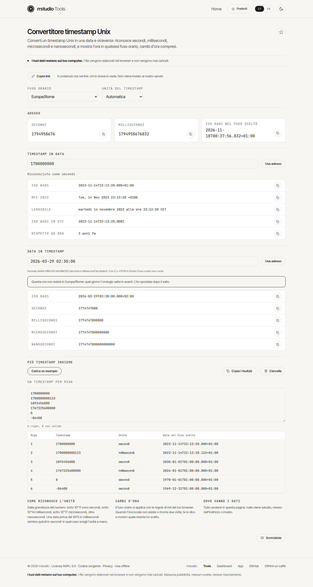

- Route `/timestamp-converter`. The unit is recognised from the magnitude (below 10^11 seconds, 10^14 milliseconds, 10^17 microseconds, otherwise nanoseconds) and can be forced; nanoseconds use BigInt.
- Time zones come from `Intl`; a local time that does not exist (clock jumps forward) or happens twice (clock goes back) is reported. Tests cover the 2026 changes in Europe/Rome and America/New_York. Supported years: 1 to 9999.

### Color contrast checker

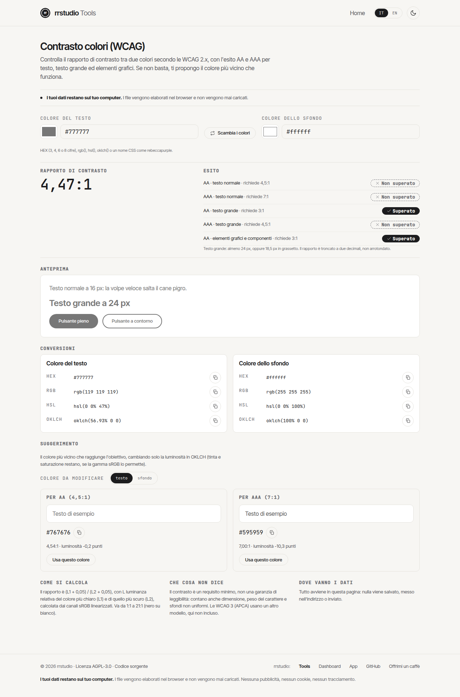

- Route `/color-contrast-checker`. WCAG 2.x relative luminance and ratio, compared with the exact value (the displayed ratio is truncated, not rounded). A transparent background is composited on white, a transparent text on the background.
- The suggestion changes only the OKLCH lightness of the chosen color (chroma is reduced only to stay in the sRGB gamut) and checks the 8-bit result.

### Markdown editor


- Route `/markdown-editor` (also `/en/markdown-editor`). Own parser (CommonMark + GFM essentials), tested on representative cases and fuzzed.
- Safety: raw HTML is shown as text, links are limited to http, https, mailto and relative, external images are shown as a clickable placeholder and never loaded automatically.
- Toolbar and shortcuts (Ctrl+B/I/K), export to `.md`, standalone HTML and PDF through the print dialog (dedicated print style). The draft is saved in `localStorage` only, with a "clear draft" button.

### Word & character counter

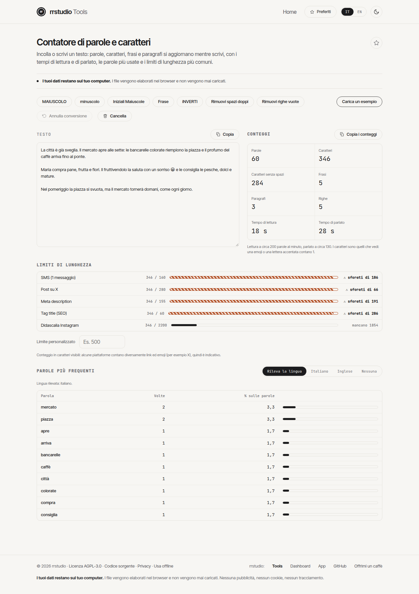

- Route `/word-counter` (also `/en/word-counter`). Characters are grapheme clusters (`Intl.Segmenter` where available), so emoji and accents count 1.
- Frequent words with automatic or chosen Italian/English stopword exclusion; limits show how many characters are left or over; case conversions with undo.

### Regex tester


- Route `/regex-tester` (also `/en/regex-tester`). Matching runs in a Web Worker that is terminated after 1 second, with a clear message; syntax errors show the engine message.
- Matches with index and groups (named too), replacement preview, token explanation (Italian/English) and examples: email, URL, date, Italian postal code, codice fiscale, IBAN.

### Text compare (diff)


- Route `/text-diff` (also `/en/text-diff`). Two text areas (or open two files), comparison by lines with the Myers O(ND) algorithm in its linear-space form, run in a Web Worker so two 5,000-line texts do not freeze the page.
- Changed lines are refined by word or by character; side-by-side or inline view, unchanged lines collapsed with a three-line context, counts of additions and removals, previous/next difference navigation.
- Options: ignore whitespace, case and blank lines. Export as a unified diff (`.patch`) or copy it.

### Hash & checksum


- MD5, SHA-1, SHA-256, SHA-384, SHA-512 of a text (live) or a file up to 2 GB read in blocks with `file.stream()`, with a progress bar and cancel; hex (optionally uppercase) and Base64, each copyable.
- SHA-1/256/384/512 use Web Crypto, which needs the whole buffer: up to 500 MB the file is assembled in memory. Above that, a warning appears and only MD5 and SHA-256 are computed, incrementally, by pure TypeScript implementations tested against the official vectors and Web Crypto.
- MD5 is not in Web Crypto (it is considered broken): it is implemented in TypeScript (RFC 1321 vectors) and flagged, like SHA-1, as not secure for cryptography.
- "Compare with a checksum": paste an expected hash (case and spaces ignored) and the matching algorithm is highlighted, or you get "No match".

### URL Encode/Decode


- `encodeURIComponent` (component) or `encodeURI` (full URL), with "space as +" for form-urlencoded data.
- Clear errors on invalid `%` sequences; a table with protocol, host, path, hash and each decoded query parameter.

### JSON Viewer & Editor

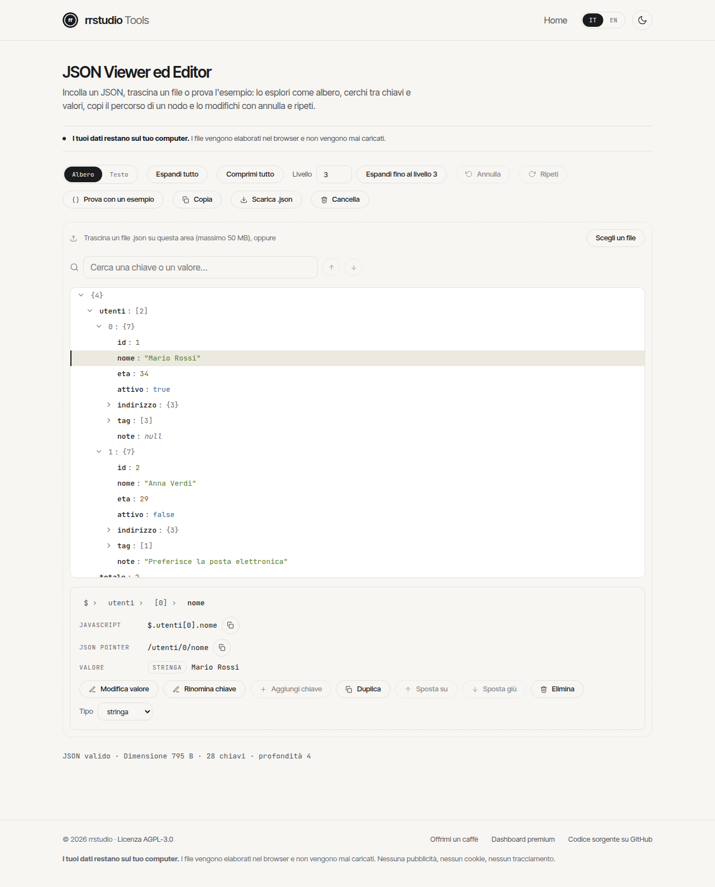

- Tree view with lazy rendering and 100-children pages, so files up to 50 MB open without freezing the page; ARIA tree keyboard navigation.
- Search by key or value with next/previous, path as `$.users[0].name` and as JSON Pointer `/users/0/name`.
- Inline editing with type validation, key rename, add, delete, duplicate, move, change type; undo/redo (Ctrl/Cmd+Z); Tree and Text views.

### JSON Formatter and Validator


- Format, minify, sort keys recursively; copy, download as `.json` or load a `.json` file by drag & drop.
- Line numbers with the error line marked; line and column are worked out for V8/Chromium, Firefox and Safari messages.
- Hand-made syntax highlighting (no editor library, no `innerHTML`).

### Italian tax code (codice fiscale)


- Calculation with the official rules (surname and name consonants, the 1st/3rd/4th consonant rule for names, month letters, day + 40 for women, cadastral code, check character); accents, apostrophes, spaces and compound surnames are handled.
- Birth place: municipality with a type-ahead combobox (ARIA pattern), or the cadastral/Z code typed by hand.
- Check and decode: length, structure, check character, sex, birth date (most plausible century plus the alternative) and place; omocodia (letters LMNPQRSTUV in place of digits) is supported in both directions and the seven omocodia variants are listed.
- The result is the "theoretical" code: the real one is assigned by the Agenzia delle Entrate. Nothing is sent or stored.
- Place data: ISTAT "Codici dei comuni, delle province e delle regioni", CC BY 4.0, saved in `public/data/luoghi.json` (about 220 kB, 74 kB gzipped, loaded only when needed) by `node scripts/update-places.mjs`. Abolished municipalities and foreign countries (Z codes) have to be exported from ISTAT's SITUAS portal and passed with `--soppressi` and `--esteri` (see the script header); until then the Z code can be typed by hand.

### Italian e-invoice viewer (FatturaPA XML/P7M)

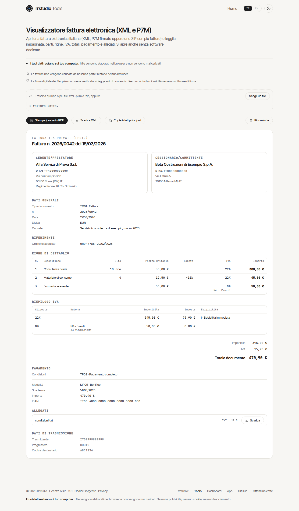

- Route `/fattura-elettronica`. Opens `.xml`, `.p7m` (CAdES, DER or Base64) and `.zip` files with several invoices. For `.p7m` a small ASN.1/DER reader (definite and indefinite lengths, fragmented OCTET STRINGs) extracts the XML from the CMS SignedData. **The signature is not verified**, and the page says so.
- Formats FPR12 (private parties), FPA12 (public bodies) and FSM10 (simplified), namespaces with or without prefix, several bodies per file. XML is read with `DOMParser` (no external stylesheets).
- Shows parties, general data (document type TD01-TD29, number, date, currency, reason, withholding, stamp duty, social security fund), references (orders, contracts, DDT), lines (quantity, price, discounts, VAT rate, nature N1-N7), VAT summary, totals and payment (terms, method MP01-MP23, due dates, IBAN). Code tables in Italian and English follow the public FatturaPA technical specifications, version 1.9.
- Attachments (Base64) are listed with name, format and size and can be downloaded. Print / save as PDF uses a dedicated print style with only the invoice; the XML extracted from a `.p7m` can be downloaded; the key details can be copied.

### VAT, VAT extraction & withholding tax (Italian)

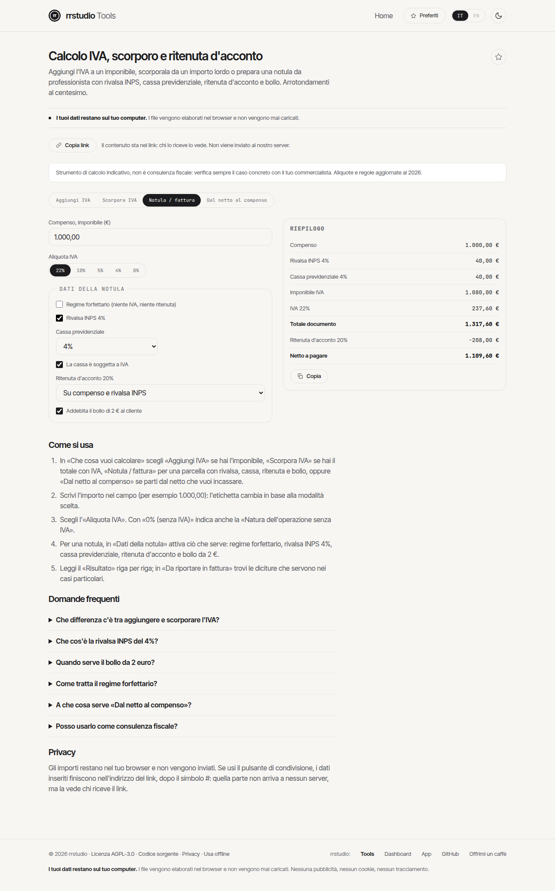

- Route `/calcolo-iva`, Italian only (`italyOnly`). Four modes: add VAT, extract VAT from a gross amount, freelancer invoice (notula), and the reverse (from the net you want to receive to the fee to invoice).
- Invoice: 4% INPS surcharge, pension fund (2%, 4%, 5% or your own, with or without VAT), VAT 22/10/5/4/0% with the exemption nature code, 20% withholding on the fee or on fee plus fund, 2 € stamp duty above 77.47 € on operations without VAT, flat-rate regime (no VAT, no withholding, with the legal notes to print). A copyable invoice-style summary.
- All amounts are integer cents and rates are in basis points: no floating-point errors, rounding to the cent. The tests include hand-checked cases. It is an indicative tool, not tax advice; rules and rates are those of 2026.

### Working days calculator (Italian)

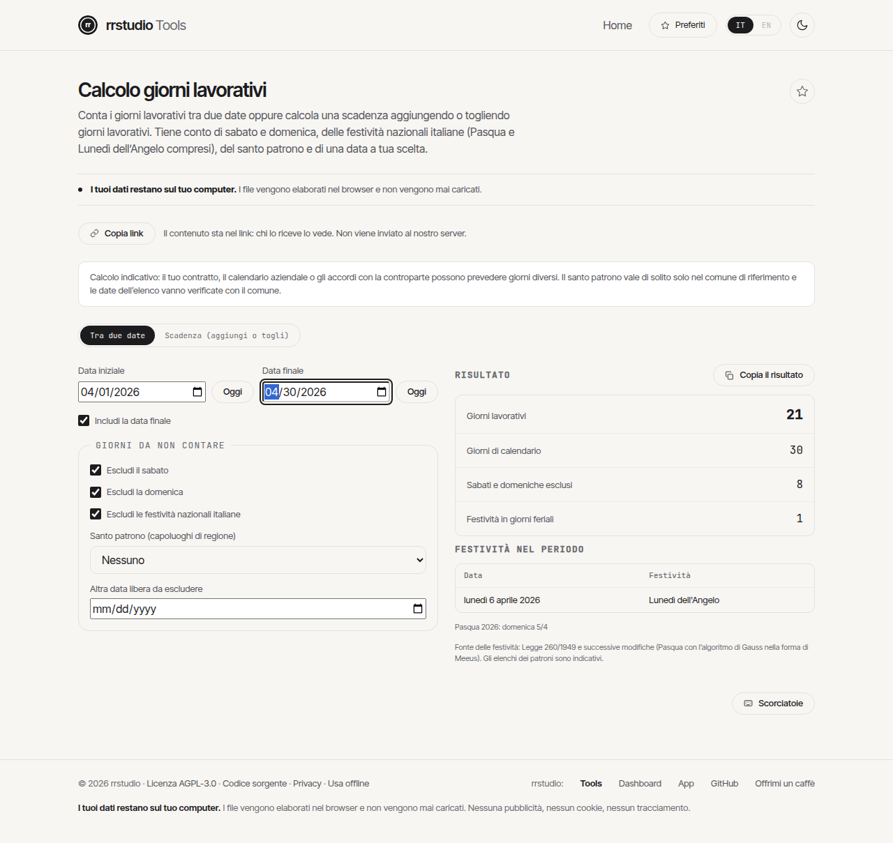

- Route `/calcolo-giorni-lavorativi`, Italian only (`italyOnly`). Between two dates (end date included or not) or add/subtract N working days.
- National holidays with Easter computed by the Gauss/Meeus algorithm (tested 2024-2030), optional patron saint of the regional capitals (indicative list, to be verified with the municipality) and one custom date.

### IBAN & Italian VAT validator

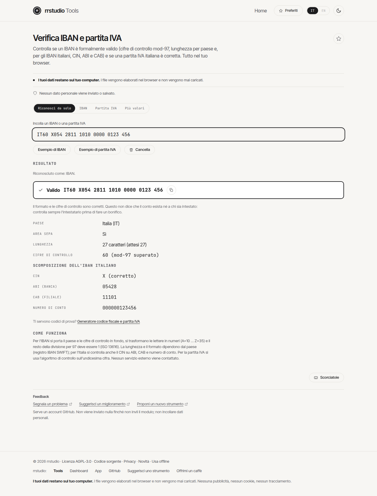

- IBAN: normalisation, mod-97 (ISO 13616), length and BBAN format per country (about 77 countries, SWIFT registry), SEPA flag, grouping by four; Italian IBANs are split into CIN, ABI, CAB and account number and the CIN is verified. The tool never guesses a "corrected" IBAN.
- Partita IVA: 11 digits, check digit, office code (digits 8-10) with the province for the historical codes 001-099; the IT prefix is accepted. A valid format does not mean the number is active (links to VIES and the Agenzia delle Entrate, no calls from the site).
- Bulk check: one value per line, results table and CSV export (formulas are neutralised).

## Privacy

- **Everything runs client-side.** There is no backend: files are read and processed by your browser and are never uploaded.
- **No external requests.** No CDNs, web fonts or third-party scripts: everything is served from the same origin, and the Content Security Policy blocks connections to other servers.
- **No cookies, no tracking, no analytics.** Only your theme, the dismissal of the "available in English" bar and, if you use the Markdown editor, its draft are saved in your browser's `localStorage`; they are never sent anywhere.
- **Technical server logs.** Like any website, the server that delivers the pages logs IP address, date and time, requested path, user agent and referrer; they are used for security and troubleshooting (never for profiling; at most an occasional aggregate look, without keeping IP addresses) and are rotated automatically after about 5 weeks. The server is hosted by Hetzner in Finland (EU). Files and text you enter in the tools never reach the server.
- Full notice (Italian and English): [`/privacy`](https://tools.rr-dev.eu/privacy) and [`/en/privacy`](https://tools.rr-dev.eu/en/privacy).

## Getting started

Requirements: Node.js 24 and npm.

```sh
git clone https://github.com/rrstudioapps/rrstudio-tools.git
cd rrstudio-tools
npm ci
npm start                 # dev server on http://localhost:4200
npm test                  # unit tests (Vitest)
npm run build             # static build in dist/rrstudio-tools/browser
```

The build is a set of static, prerendered files (`/index.html`, `/csv-dashboard/index.html`, `/base64/index.html`, JS, CSS, fonts):
upload `dist/rrstudio-tools/browser` to any static host. Configure the host to serve `<path>/index.html`
for `<path>` (most do by default). A ready-made Docker image (nginx, non-root, strict CSP) is in
[`Dockerfile`](Dockerfile) and [`deploy/`](deploy/).

### Adding a tool

Each tool lives in its own folder under `src/app/tools/<id>/` and is a lazy-loaded route. Add it to
`src/app/tools/tools.registry.ts` and it gets its route, its card on the home page and its SEO tags.
See [CONTRIBUTING.md](CONTRIBUTING.md).

### Tech stack

Angular 22 (standalone components, signals, zoneless, prerendering) · TypeScript · Apache ECharts via
ngx-echarts · PapaParse · SheetJS Community Edition · html2canvas · jsPDF · Fontsource (Inter Tight,
JetBrains Mono). Third-party licenses: [THIRD_PARTY_LICENSES.md](THIRD_PARTY_LICENSES.md).

## License

rrstudio Tools is © 2026 rrstudio and is released under the
[GNU Affero General Public License v3.0 or later](LICENSE) (AGPL-3.0-or-later).

- ✅ **Free to use** for any purpose, personal or commercial, and free to study, copy and modify.
- 🔁 **Share alike.** If you distribute a modified version, **or host it as a service that other people use over a network**, you must release your complete source code under the same license (AGPL-3.0, section 13).
- 🏷️ **Keep the attribution.** Keep the copyright headers, the [NOTICE](NOTICE) file and a visible "Based on rrstudio Tools by rrstudio" credit linking to this repository. The rrstudio name and logo are not licensed for promoting modified versions.

This is a summary, not legal advice: the [LICENSE](LICENSE) and [NOTICE](NOTICE) files are what count.

## Support

rrstudio Tools is free and has no ads. If it is useful to you:
[buy me a coffee on Ko-fi](https://ko-fi.com/rrstudioapps), or take a look at the
[premium dashboards](https://demo.rr-dev.eu) (live demos, free download, pay what you want).

---

## In italiano

**rrstudio Tools** è una raccolta di strumenti web gratuiti e open source che funzionano interamente
nel browser. **I tuoi dati restano sul tuo computer:** nessun backend, nessun upload, nessuna chiamata
a server esterni, nessun cookie, nessun tracciamento o analytics.

- **Prova online:** [tools.rr-dev.eu](https://tools.rr-dev.eu). Strumenti:
  [CSV → Dashboard](https://tools.rr-dev.eu/csv-dashboard), che da un CSV o un Excel genera KPI,
  grafici e tabella, esportabili in HTML autonomo, PNG e PDF. Poi
  [Base64](https://tools.rr-dev.eu/base64), [URL Encode/Decode](https://tools.rr-dev.eu/url-encode) e
  [JSON Formatter](https://tools.rr-dev.eu/json-formatter), [JSON Viewer ed Editor](https://tools.rr-dev.eu/json-viewer) (albero, ricerca, modifica con annulla/ripeti) e
  [Comprimi e converti immagini](https://tools.rr-dev.eu/image-compressor) (JPEG, WebP, PNG, AVIF, con
  confronto prima/dopo e ZIP) e [Strumenti PDF](https://tools.rr-dev.eu/pdf-tools) (unisci, dividi, ruota),
  [Generatore di password](https://tools.rr-dev.eu/password-generator) (password e passphrase, con
  entropia) e [Hash e checksum](https://tools.rr-dev.eu/hash-generator) (MD5, SHA-1, SHA-256, SHA-384,
  SHA-512 di testi e file), [Codice fiscale](https://tools.rr-dev.eu/codice-fiscale) (calcolo, verifica,
  omocodia), [Verifica IBAN e partita IVA](https://tools.rr-dev.eu/iban-partita-iva),
  [Visualizzatore fattura elettronica](https://tools.rr-dev.eu/fattura-elettronica) (XML e P7M),
  [Da immagini a PDF](https://tools.rr-dev.eu/images-to-pdf) e [Da PDF a immagini](https://tools.rr-dev.eu/pdf-to-images),
  [Metadati foto EXIF](https://tools.rr-dev.eu/exif-viewer) (visualizza e rimuovi senza ricomprimere),
  [Generatore di QR code](https://tools.rr-dev.eu/qr-code-generator) (testo, link, WiFi, contatto, email, SMS, posizione; PNG e SVG),
  [Calcolo IVA e ritenuta d'acconto](https://tools.rr-dev.eu/calcolo-iva) (scorporo, notula, rivalsa INPS, cassa, bollo, forfettario),
  [Confronto testi (diff)](https://tools.rr-dev.eu/text-diff),
  [Editor Markdown](https://tools.rr-dev.eu/markdown-editor), [Contatore di parole e caratteri](https://tools.rr-dev.eu/word-counter),
  [Tester di espressioni regolari](https://tools.rr-dev.eu/regex-tester), [Calcolo giorni lavorativi](https://tools.rr-dev.eu/calcolo-giorni-lavorativi) e
  [Convertitore CSV, JSON ed Excel](https://tools.rr-dev.eu/csv-json-converter), tutti con
  elaborazione solo nel browser.
- **Installazione:** `npm ci`, poi `npm start` per lo sviluppo e `npm run build` per la build
  statica (`dist/rrstudio-tools/browser`, pubblicabile su qualsiasi hosting statico).
- **Licenza:** AGPL-3.0-or-later. L'uso è libero, anche commerciale. Chi distribuisce una versione
  modificata **o la ospita come servizio online** deve rilasciarne il codice sorgente con la stessa
  licenza e mantenere l'attribuzione ("Based on rrstudio Tools by rrstudio", file NOTICE e
  intestazioni). Dettagli in [LICENSE](LICENSE) e [NOTICE](NOTICE).
- **Contribuire:** leggi [CONTRIBUTING.md](CONTRIBUTING.md).
